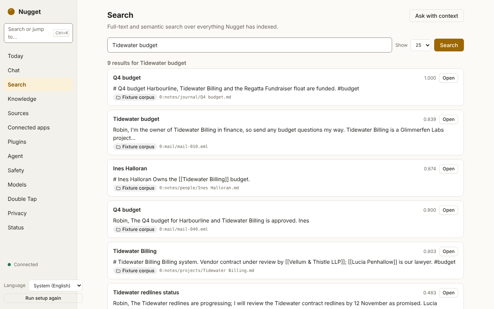
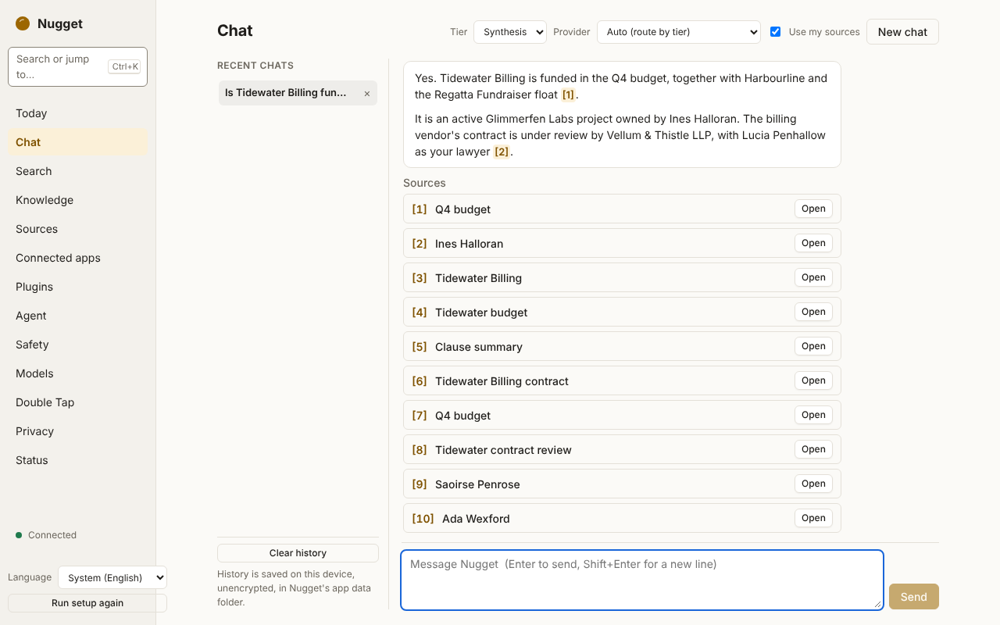
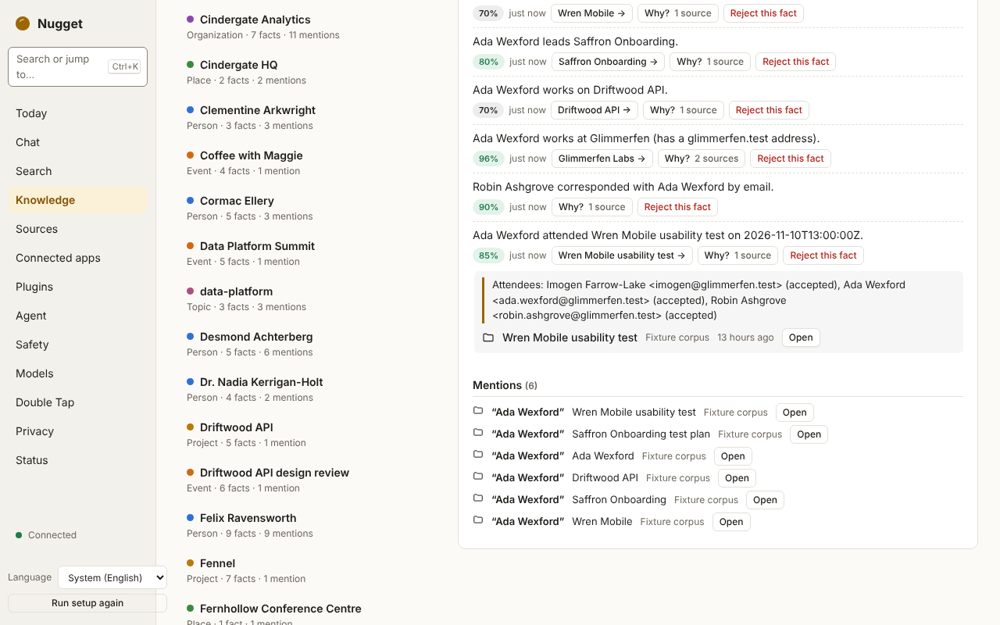
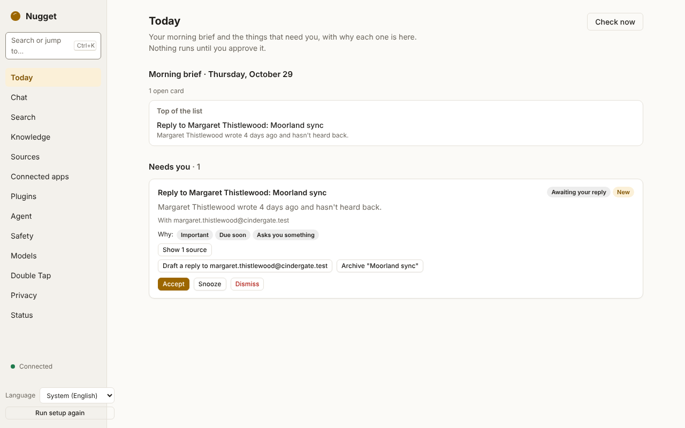
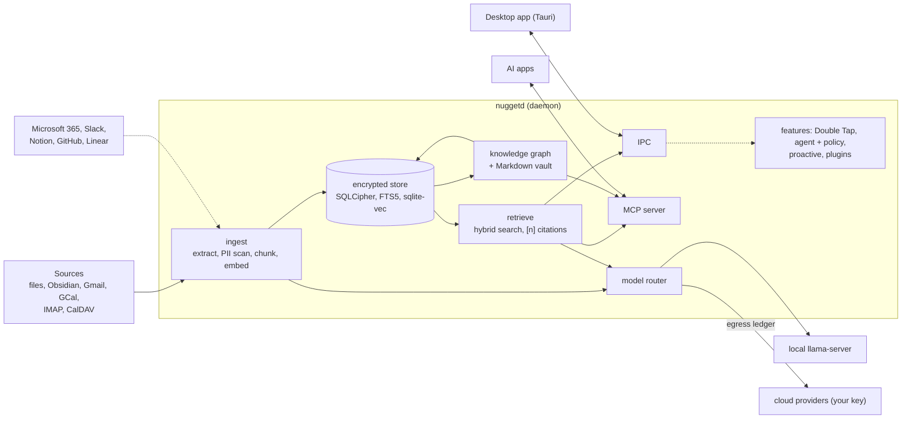

# Nugget

Nugget is an open-source (Apache-2.0), local-first, cross-platform personal AI. A per-user daemon
indexes your files, notes, mail and calendars continuously into an encrypted store on your machine,
builds a knowledge graph in which every fact cites its source, and answers questions with `[n]`
citations, using local models or your own API keys. Every request that leaves your device is recorded
where you can see it. Other AI apps can read your knowledge through a local MCP server, with a scoped
token per app. Drafting in any app, an agent that operates your computer under a safety policy,
proactive cards and plugins are being wired in now.

## Status

Built from source; there are no installers or signed releases yet.

| Area | State |
|---|---|
| Daemon (`nuggetd`), per-user service, local IPC | Runs today (M0) |
| Encrypted store: SQLCipher, full-text and vector search, egress ledger, hash-chained audit log | Runs today (M0) |
| Models: local `llama-server` from a signed manifest, any OpenAI-compatible server, or Anthropic and OpenAI with your key | Runs today (M0–M1) |
| Sources: folders, Obsidian, Gmail, Google Calendar, IMAP, CalDAV, with live edits and deletes | Runs today (M1) |
| Search and Ask with citations | Runs today (M1) |
| Knowledge graph and Markdown vault | Runs today (M2) |
| MCP server (stdio and loopback HTTP, scoped per-client tokens) | Runs today (M2) |
| Double Tap: drafting in any text field | Being wired in (M3) |
| Agent, computer use and the safety policy engine | Being wired in (M4) |
| Proactive cards and the morning brief (Today) | Being wired in (M5) |
| WASM plugins; Microsoft 365, Slack, Notion, GitHub and Linear connectors | Being wired in (M6) |
| Installers, signed releases, auto-update | Not started |

"Being wired in" means the crates exist and are tested, and the daemon and app integration is in
progress. Do not rely on them yet. The book's [What works today](docs/book/src/status.md) page has the
details.

## Why Nugget

- **Your data stays local and encrypted.** One SQLCipher database, key in the OS keychain. No
  telemetry and no first-party servers.
- **You can see what leaves.** An egress ledger records host, feature, bytes and items for every
  off-device request. Items flagged sensitive are never sent to a cloud model.
- **Memory you can check.** Hybrid search, and a knowledge graph where every claim carries a quote
  from its source. The Markdown vault is yours to edit; edits merge back.
- **Safe sharing with other AI apps.** Local MCP only, one revocable token per app, scoped by source
  and tool, every call audited, no secrets in URLs.
- **Built for actions with guard rails.** The agent (being wired in) runs behind a policy engine with
  risk classes, confirmations, budgets, a kill switch and a hash-chained action log.
- **Cross-platform and permissive.** macOS, Windows and Linux; Apache-2.0.

How this compares with Sentient OS, with sources for every claim:
[docs/compare/sentient-os.md](docs/compare/sentient-os.md).

## Screenshots

The desktop app on a fictional corpus (light or dark follows your system). More in the
[user guide](docs/book/src/guide/first-run.md); they are regenerated from the real app with
`pnpm run screenshots` in `apps/desktop`.

<p>
<picture>
  <source media="(prefers-color-scheme: dark)" srcset="docs/book/src/images/screenshots/search-dark.png">
  
</picture>
<picture>
  <source media="(prefers-color-scheme: dark)" srcset="docs/book/src/images/screenshots/chat-dark.png">
  
</picture>
</p>
<p>
<picture>
  <source media="(prefers-color-scheme: dark)" srcset="docs/book/src/images/screenshots/knowledge-why-dark.png">
  
</picture>
<picture>
  <source media="(prefers-color-scheme: dark)" srcset="docs/book/src/images/screenshots/today-dark.png">
  
</picture>
</p>

## Architecture

Solid lines run today; dashed lines are being wired in. The
[architecture overview](docs/book/src/architecture/overview.md) has the full diagram and a walk-through.



## Quick start

You need Rust (rustup; `rust-toolchain.toml` picks the toolchain, MSRV 1.88), a C toolchain, `make`
and `perl`. The desktop app also needs Node.js 22, pnpm and the
[Tauri 2 prerequisites](https://v2.tauri.app/start/prerequisites/). Platform details are in the
[install guide](docs/book/src/guide/install.md).

```sh
git clone https://github.com/rayhankhilji/nugget
cd nugget

# The daemon
cargo build --release -p nuggetd
./target/release/nuggetd                  # runs in the foreground
./target/release/nuggetd status           # from another terminal

# The desktop app (optional; it starts the daemon for you)
cd apps/desktop && pnpm install --frozen-lockfile && pnpm build && cd ../..
cargo build --release -p nugget-desktop
./target/release/nugget-desktop
```

To keep development data separate, pass `--home /tmp/nugget-dev` to `nuggetd`. To connect an AI app
over MCP, see [the MCP guide](docs/book/src/guide/mcp.md).

## Documentation

- **[The Nugget book](docs/book/src/introduction.md)** (`docs/book`, built with mdBook): user guide,
  reference, architecture and contributor docs.
- [docs/PLAN.md](docs/PLAN.md): the plan and milestones.
- [docs/research/](docs/research/): clean-room research.

## Contributing, security, licence

- [CONTRIBUTING.md](CONTRIBUTING.md): setup, DCO sign-off (no CLA) and the clean-room rules.
- [SECURITY.md](SECURITY.md): how to report a vulnerability.
- Licensed under [Apache-2.0](LICENSE).
