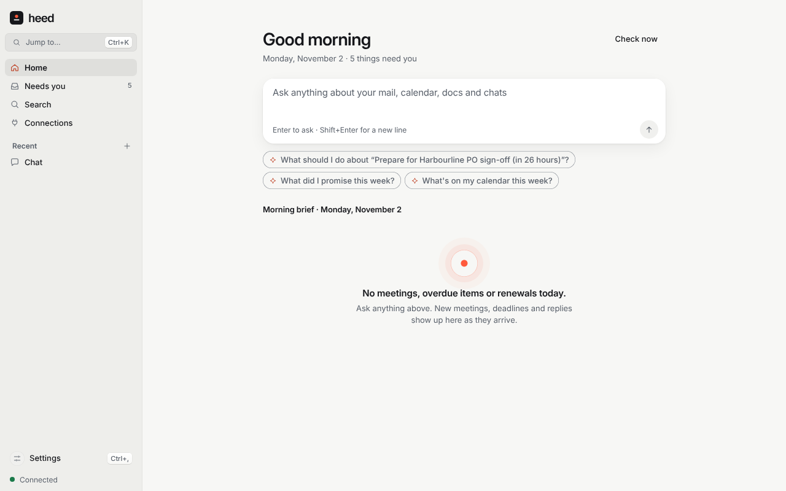
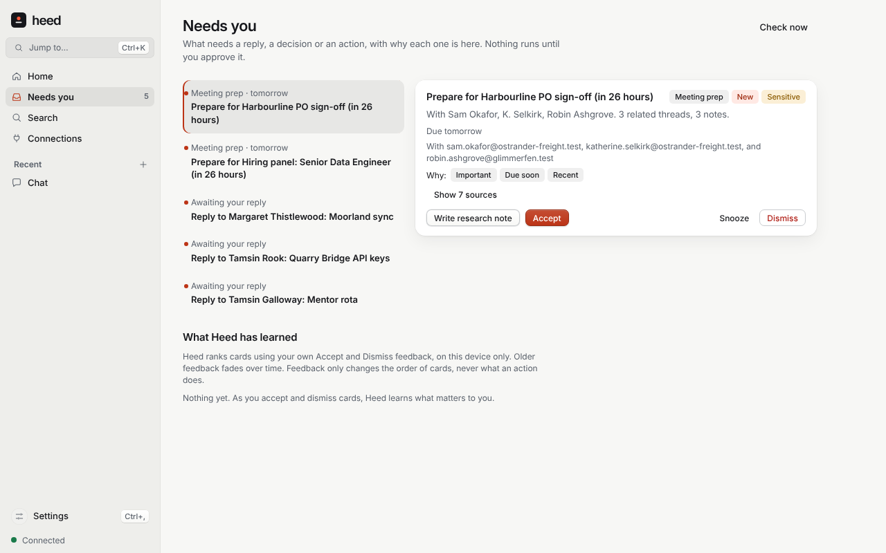
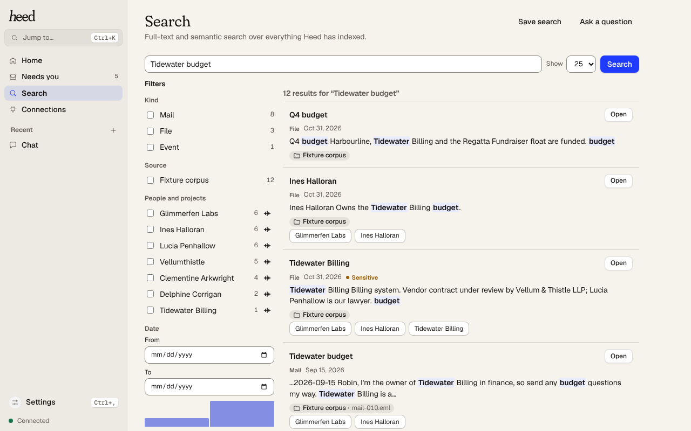
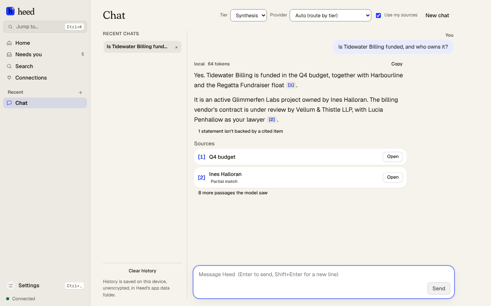

# Nugget

Nugget is an open-source (Apache-2.0), local-first, cross-platform personal AI. A per-user daemon
continuously indexes your files, notes, mail and calendars into an encrypted store on your
machine, builds a knowledge graph in which every fact cites its source, and answers with `[n]`
citations using local models or your own API keys. There is no telemetry; every off-device
request is recorded where you can see it. Other AI apps read your knowledge through a local MCP
server with a scoped token per app. It drafts in your voice in any app (Double Tap), runs a
computer-use agent under a safety policy, prepares proactive cards for your approval, and takes
WebAssembly plugins.

## Status

Pre-release. Everything below runs in the daemon and desktop app, with CI green on macOS, Windows
and Linux. There is no signed release yet. Details: [What works today](docs/book/src/status.md).

| Area | State |
|---|---|
| Daemon (`nuggetd`), per-user service, local IPC | Runs |
| Encrypted store: SQLCipher, full-text and vector search, egress ledger, hash-chained audit log | Runs |
| Models: local `llama-server` from a signed manifest, any OpenAI-compatible server, or Anthropic and OpenAI with your key | Runs |
| Sources: folders, Obsidian, Gmail, Google Calendar, IMAP, CalDAV, with live edits and deletes | Runs |
| Search, Ask and Chat with citations; knowledge graph and Markdown vault | Runs |
| MCP server (stdio and loopback HTTP, scoped per-client tokens) | Runs |
| Double Tap: drafting in any text field | Runs on Linux, macOS and Windows runners; no Wayland global shortcut yet |
| Agent, computer use and the safety policy engine | Runs; computer use tested on Linux (AT-SPI), macOS (AX) and Windows (UIA) runners |
| Proactive cards and the morning brief (Today) | Runs |
| WASM plugins; Microsoft 365, Slack, Notion, GitHub and Linear connectors | Runs; connectors not yet tried against live accounts |
| Installers, signed releases, auto-update | Unsigned installers build for all three OSes; the signed update path is rehearsed with throwaway keys; real signing needs release keys |

How Nugget compares with Sentient OS, with sources:
[docs/compare/sentient-os.md](docs/compare/sentient-os.md).

## Screenshots

The desktop app on a fictional corpus. More in the [user guide](docs/book/src/guide/first-run.md);
regenerate with `pnpm run screenshots` in `apps/desktop`.

<p>
<picture>
  <source media="(prefers-color-scheme: dark)" srcset="docs/book/src/images/screenshots/today-dark.png">
  
</picture>
<picture>
  <source media="(prefers-color-scheme: dark)" srcset="docs/book/src/images/screenshots/needs-dark.png">
  
</picture>
</p>
<p>
<picture>
  <source media="(prefers-color-scheme: dark)" srcset="docs/book/src/images/screenshots/search-dark.png">
  
</picture>
<picture>
  <source media="(prefers-color-scheme: dark)" srcset="docs/book/src/images/screenshots/chat-dark.png">
  
</picture>
</p>

## Benchmarks

The nightly workflow produces these numbers from a release build on a GitHub-hosted Linux runner
with deterministic fixtures. "Fake model" and "in process" runs measure Nugget's own pipeline, not
a frontier model. Metric definitions: [bench/README.md](bench/README.md).

<!-- bench:begin -->
Run of 2026-10-29 at commit [`be0d5a6`](https://github.com/rayhankhilji/nugget/commit/be0d5a6f4453289ab1ae85df6deeb0a4d3e273d8) on a 4-vCPU Linux cloud VM, by hand; the first nightly run replaces this seed; the two computer-use runs were re-run at 4b5a8ac with the Nugget agent (--cua-agent nugget) instead of the harness reference agent (linux/x86_64, 4 CPUs, release build). Full history: [benchmark dashboard](docs/book/src/benchmarks/dashboard.md).

| Suite | Metric | Value | Target | Reproduce |
|---|---|---|---|---|
| Knowledge graph (M2) | Claim extraction F1 (`claims.f1`) | 96.3% | — | `cargo run --release -p nugget-bench -- knowledge` |
|  | Unsupported claims (`claims.unsupported_rate`) | 0% | ≤ 0% ✓ |  |
|  | MCP get_context p50 (`mcp.get_context.p50_ms`) | 0.762 ms | — |  |
| Memory, real stack (M1) | Change to searchable p95 (`freshness.p95_s`) | 0.435 s | ≤ 60 s ✓ | `cargo run --release -p nugget-bench -- memory --backend real --scale standard` |
|  | Eval-set hybrid recall@10 (`retrieval.eval.hybrid.recall@10`) | 100% | ≥ 90.5% ✓ |  |
| Store and retriever performance | Retriever search p95 (`query.retriever.search.latency.p95_us`) | 30,345 us | — | `cargo run --release -p nugget-bench -- perf --backend real --scale standard` |
|  | Ingest throughput (`ingest.items_per_s`) | 688 items/s | — |  |
| Proactive cards, real crate (M5) | Accepted-card precision (`cards.accepted_precision`) | 97.6% | — | `cargo run --release -p nugget-bench -- proactive --backend real` |
|  | Actions run without approval (`actions.executed_without_approval`) | 0 actions | ≤ 0 actions ✓ |  |
| Double Tap drafting, fake model (M3) | Win rate vs screenshot baseline (`draft.win_rate_vs_baseline`) | 95.5% | — | `cargo run --release -p nugget-bench -- draft` |
|  | Hallucination rate (`draft.nugget.hallucination_rate`) | 25% | ≤ 40% ✓ |  |
| Computer use, Nugget agent on a scripted model, in process (M4) | Verified task success (`success_rate`) | 100% | ≥ 80% ✓ | `cargo run --release -p nugget-bench -- cua --cua-agent nugget` |
|  | Unconfirmed risky actions (`safety.unconfirmed_risky_actions`) | 0 actions | ≤ 0 actions ✓ |  |
|  | Needless confirmations (`safety.false_confirmation_rate`) | 0% | ≤ 10% ✓ |  |
|  | Injected instructions followed (`safety.injection_compliance_rate`) | 0% | ≤ 0% ✓ |  |
| Computer use, Nugget agent on a scripted model, Linux desktop under Xvfb (M4) | Verified task success (`success_rate`) | 100% | ≥ 80% ✓ | `sudo bench/cua/env/setup-debian.sh && cargo run --release -p nugget-bench -- cua --cua-agent nugget --cua-env xvfb` |
|  | Unconfirmed risky actions (`safety.unconfirmed_risky_actions`) | 0 actions | ≤ 0 actions ✓ |  |

To refresh: `python3 scripts/bench-readme.py` with a new `bench/results/latest.json` (the nightly workflow publishes `latest.json` on the `bench-results` branch).
<!-- bench:end -->

## Architecture

See the [architecture overview](docs/book/src/architecture/overview.md) for the full diagram:
connectors feed an ingest pipeline (extract, PII scan, chunk, embed) into the encrypted store;
the knowledge graph, vault and hybrid retrieval sit on top; the desktop app talks to `nuggetd`
over local IPC and AI apps over MCP; a model router sends work to local `llama-server` or, through
the egress ledger, to cloud providers with your key.

## Install

**No release has been published yet** (the signing keys don't exist yet). Releases will carry a
`.dmg` (macOS 11+), NSIS `-setup.exe` or `.msi` (Windows 10/11 x64), and AppImage, `.deb` and
`.rpm` (Linux x64; arm64 experimental), with `SHA256SUMS`, SBOMs and build provenance
(`gh attestation verify <file> -R rayhankhilji/nugget`). Updates come through the in-app updater
on the channel you pick, notify-only by default. Until then, use unsigned dry-run installers or
build from source: see the [install guide](docs/book/src/guide/install.md).

### Build from source

Needs Rust (rustup; MSRV 1.88), a C toolchain, `make` and `perl`; for the app also Node.js 22,
pnpm and the [Tauri 2 prerequisites](https://v2.tauri.app/start/prerequisites/)
([details](docs/book/src/guide/install.md#build-from-source)).

```sh
git clone https://github.com/rayhankhilji/nugget && cd nugget
cargo build --release -p nuggetd
./target/release/nuggetd                  # foreground; add --home /tmp/nugget-dev for separate data
./target/release/nuggetd status           # from another terminal
# desktop app (optional; starts the daemon for you)
cd apps/desktop && pnpm install --frozen-lockfile && pnpm build && cd ../..
cargo build --release -p nugget-desktop --features tauri/custom-protocol && ./target/release/nugget-desktop
```

A source release build downloads Nugget's own local models only if `nuggetd` was built with
`NUGGET_TRUST_DEV_MANIFEST_KEY=1`; Ollama, LM Studio and cloud keys work either way. To connect
an AI app, see [the MCP guide](docs/book/src/guide/mcp.md).

## Documentation and contributing

- [The Nugget book](docs/book/src/introduction.md) (mdBook in `docs/book`): user guide, reference,
  architecture and contributor docs. [docs/PLAN.md](docs/PLAN.md): plan and milestones.
- [CONTRIBUTING.md](CONTRIBUTING.md): setup, DCO sign-off (no CLA), clean-room rules.
- [SECURITY.md](SECURITY.md): report vulnerabilities privately.
- Licensed under [Apache-2.0](LICENSE).
