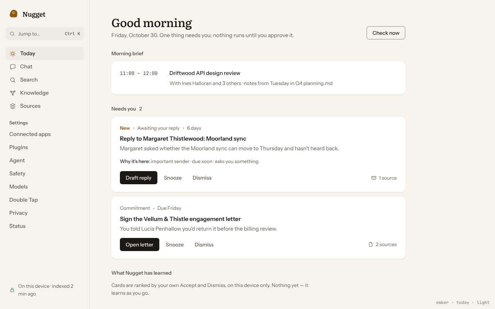
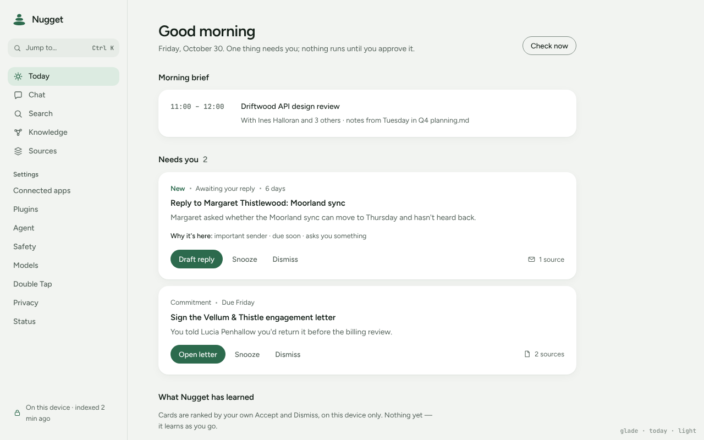
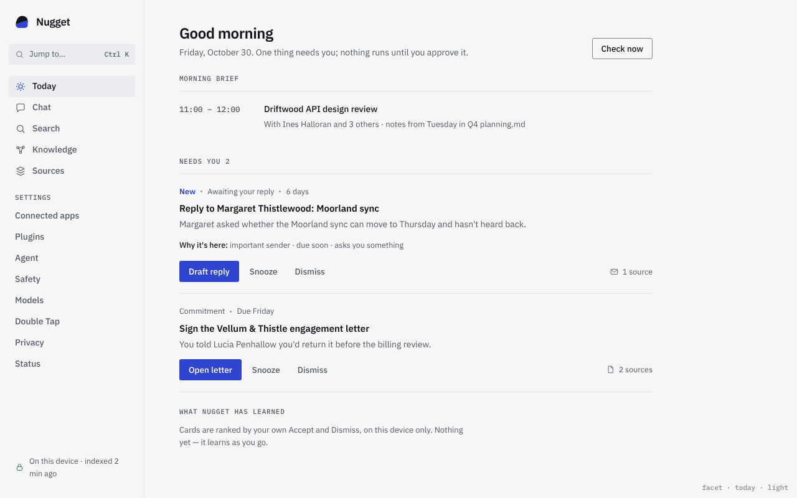
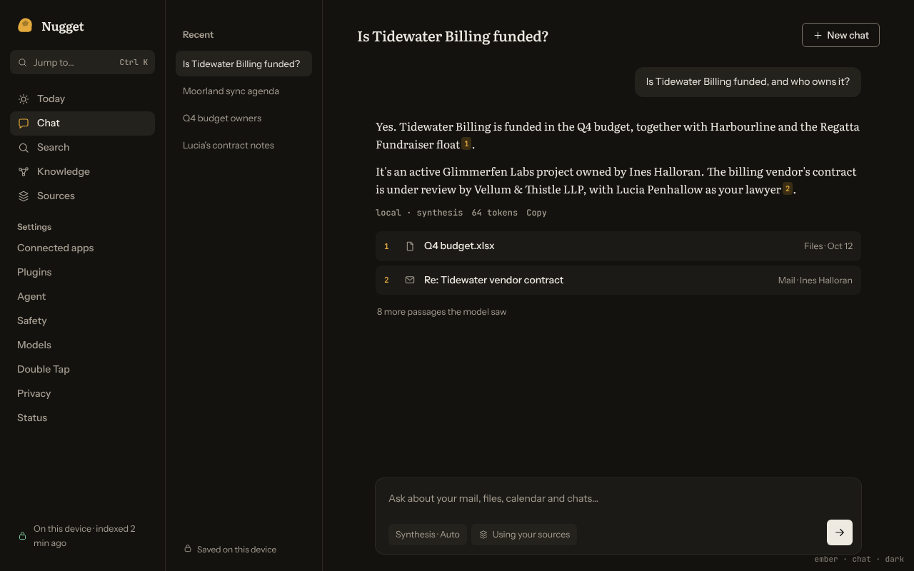
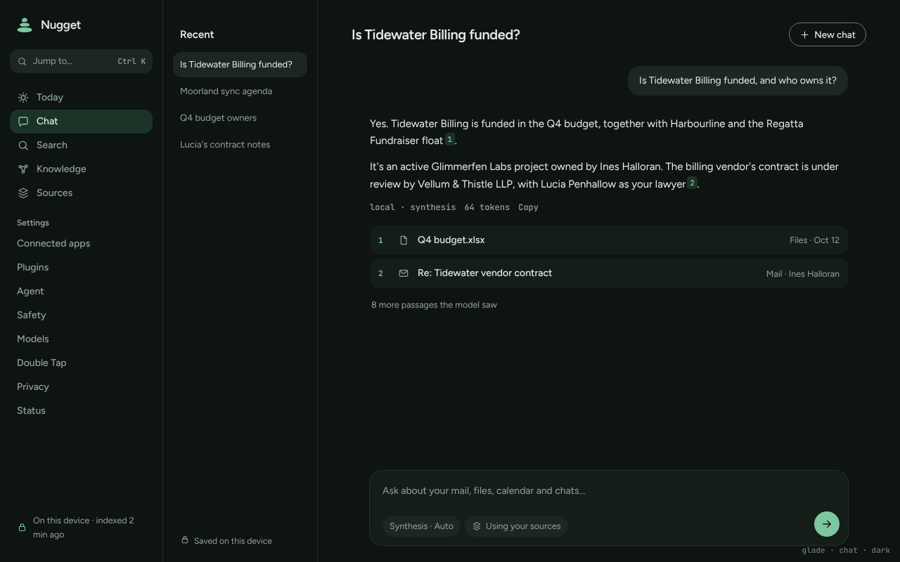
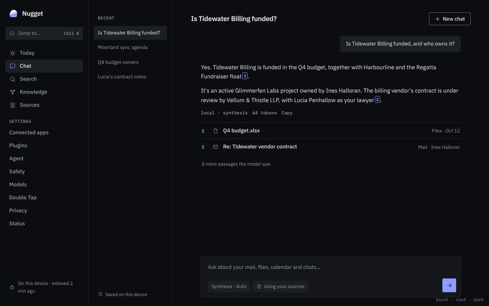

# Brand directions

Three candidate identities for Nugget. Each is shown as a Today mockup (light theme) and a Chat
mockup (dark theme), at 1280×800, plus a sheet of the three marks (`logos.png`). They're static
HTML mockups with the real fonts, not the app. Pick one and the token values, marks and fonts are
applied in phase 3. The direction-neutral cleanup (tokens, less noise, motion) is the same for all
three.

All three share the same structure, which is the noise-reduction plan: no pills; reasons shown as a
quiet sentence; one filled primary action per card, with secondary actions as plain text buttons;
the source count instead of a "Show 1 source" button; an answer shown as text instead of a bubble;
and a single composer that holds the tier, provider and "use my sources" options.

| | Ember | Glade | Facet |
| --- | --- | --- | --- |
| Today |  |  |  |
| Chat |  |  |  |

## 1. Ember: warm, editorial, trustworthy (recommended)

**Personality.** A good notebook with a careful librarian. Calm, literate, a little old-fashioned in
the good sense. The name finally means something: your data is the gold, and it stays in your
hands. This is the evolutionary option, so people who know the current amber app will still
recognise it.

**Mark.** A lumpy gold nugget with one lighter cut facet, showing raw material that's been looked
after. It works as a filled silhouette down to 16 px. The app icon puts the gold nugget on an ink
tile.

**Palette.** Gold is rare. It's only for the mark, the active nav icon, citations and "New".
Primary actions are ink, not orange.

| token | light | dark |
| --- | --- | --- |
| bg / surface / raised | `#F5F3EE` / `#FFFFFF` / `#EEEBE4` | `#13120F` / `#1B1A16` / `#24221D` |
| text / muted | `#1B1915` / `#615B51` | `#EEEAE2` / `#A79F92` |
| line / control border | `#E2DDD3` / `#8A8375` | `#2D2A24` / `#7C7569` |
| accent (gold) / soft / on-accent | `#8F5700` / `#F5EBD3` / `#FFFFFF` | `#E3A93C` / `#3A2D14` / `#1B1406` |
| primary button (ink / on-ink) | `#1B1915` / `#F5F3EE` | `#EEEAE2` / `#13120F` |
| good / bad / focus | `#2B6E46` / `#A7301F` / `#2357C6` | `#7DCB9B` / `#FF8E7E` / `#86B2FF` |

**Type.** Literata (variable, OFL) for the display font and for answer text. Instrument Sans
(variable, OFL) for the UI. JetBrains Mono (OFL) for times, token counts and shortcuts. Latin and
Latin-ext together are about 140 KB of woff2. The fallbacks are Noto Naskh Arabic for display and
IBM Plex Sans Arabic for UI, Noto Serif and Sans Devanagari, and the system's CJK fonts (PingFang,
Hiragino, Yu Gothic, Microsoft YaHei, Noto CJK). Bundling CJK would add 4–10 MB per script, so
those fall back to the system.

**Spacing and radius.** The 4-pt scale is 4, 8, 12, 16, 24, 32 and 48, with 28 px between page
sections. Radii are 12 for cards, 8 for controls and 6 for buttons. Cards have no border, only a
hairline under-shadow.

**Motion.** Soft and settled: things arrive, they don't bounce. Durations are 120, 180 and 240 ms,
easing in with `cubic-bezier(.2,0,0,1)` and out with `cubic-bezier(.4,0,1,1)`. Entering content
fades with a 6 px rise. With `prefers-reduced-motion` this becomes an opacity change only, at 0 ms.

**Icons.** 24-px grid, 1.6 stroke, round caps and joins, open shapes. Only outline icons are used,
and they're sparse: navigation and source types only.

## 2. Glade: calm, soft, quietly natural

**Personality.** A quiet room with a plant in it. The friendliest of the three and the furthest from
"AI tool". Pine green stands for safety, privacy and calm, and other AI apps rarely use it.

**Mark.** A small cairn of three balanced stones, for something steady that you placed yourself.
It drops the gold metaphor, so the name and the mark tell different stories.

| token | light | dark |
| --- | --- | --- |
| bg / surface / raised | `#F2F4F1` / `#FFFFFF` / `#E7ECE7` | `#0E1411` / `#151D19` / `#1D2722` |
| text / muted | `#152019` / `#54625A` | `#E3EBE5` / `#93A39A` |
| line / control border | `#DAE1DB` / `#7F8C84` | `#25302A` / `#6C7C73` |
| accent (pine) / soft / on-accent | `#2C6A4D` / `#DCEBE1` / `#FFFFFF` | `#7CC7A0` / `#1B3226` / `#0B1510` |
| bad / focus | `#A83A2C` / `#2C6A4D` | `#FF9283` / `#9AD8B6` |

**Type.** Figtree (variable, OFL) for everything, which is very light at about 32 KB for Latin, and
JetBrains Mono for numbers. The fallbacks are Noto Sans Arabic, Noto Sans Devanagari and the
system CJK fonts.

**Spacing and radius.** Roomy: 32 px between sections and 20–22 px of card padding. Radii are 18
for cards, 12 for controls, and fully rounded buttons. Cards have a soft two-layer shadow.

**Motion.** Gentle, with a slightly longer settle. Durations are 140, 200 and 240 ms with
`cubic-bezier(.25,.1,.25,1)`. Entering content fades with an 8 px rise, and cards scale from 0.98.
Reduced motion turns this into an opacity change only.

**Icons.** 1.75 stroke, round, friendly, with slightly larger counters.

## 3. Facet: precise, instrument-like, transparent

**Personality.** A well-made instrument: dense, honest and legible, showing where everything came
from. Monospace metadata makes provenance visible. This option suits power users and people who
want to audit what the app does.

**Mark.** A nugget cut once with a straight line, ink above and cobalt below. It reads as
precision applied to raw material.

| token | light | dark |
| --- | --- | --- |
| bg / surface / raised | `#F6F6F7` / `#FFFFFF` / `#ECEDF0` | `#0C0D10` / `#14161A` / `#1C1F25` |
| text / muted | `#111318` / `#565B67` | `#E5E7EC` / `#969BA8` |
| line / control border | `#E2E3E8` / `#80848F` | `#252831` / `#6E7380` |
| accent (cobalt) / soft / on-accent | `#2F45D0` / `#E6E9FB` / `#FFFFFF` | `#8E9DFF` / `#1D2244` / `#0C0D10` |
| good / bad | `#1E7347` / `#B02A2A` | `#74D19E` / `#FF8C8C` |

**Type.** The IBM Plex superfamily (OFL) is the strongest choice for i18n here, because one design
covers Plex Sans, Sans Arabic, Sans Devanagari and Sans JP. Plex Mono is used for metadata and the
uppercase section labels. Simplified Chinese falls back to Noto Sans SC or the system. Latin and
Latin-ext in three weights plus the mono come to about 190 KB.

**Spacing and radius.** Compact: 24 px between sections. Radii are 6, 4 and 3. Hairline rules
replace cards, so lists are separated by lines rather than boxes.

**Motion.** Crisp and almost mechanical. Durations are 100, 160 and 200 ms with
`cubic-bezier(.3,0,0,1)`. Elements move 4 px and nothing scales. Reduced motion means no movement
at all.

**Icons.** 1.5 stroke, square-ish joins, technical.

## Contrast

Every pair the UI uses was checked against WCAG AA in both themes: text on bg, surface and raised;
muted text; accent on surface and accent-soft; on-accent on accent; good and bad; and control
borders and focus rings at 3:1. The lowest ratios are muted text at 6.4:1 and control borders at
3.5:1. Every pair passes.

## Why Ember

It's the only option where the name, the mark and the colour tell one story: a nugget of your data,
kept by you. It keeps the recognition of today's amber while removing what makes the app feel
generic. The serif answer text makes cited answers feel considered rather than chatty. Ink primary
buttons hold the gold back, so the screen stays calm. Warm off-white with a serif is a popular look
right now, so Ember stays distinct with ink-not-orange actions, gold only as a rare accent, and the
nugget mark. Facet is the runner-up: it has the best multi-script story and the most "trustworthy
instrument" feel, but it's colder.
