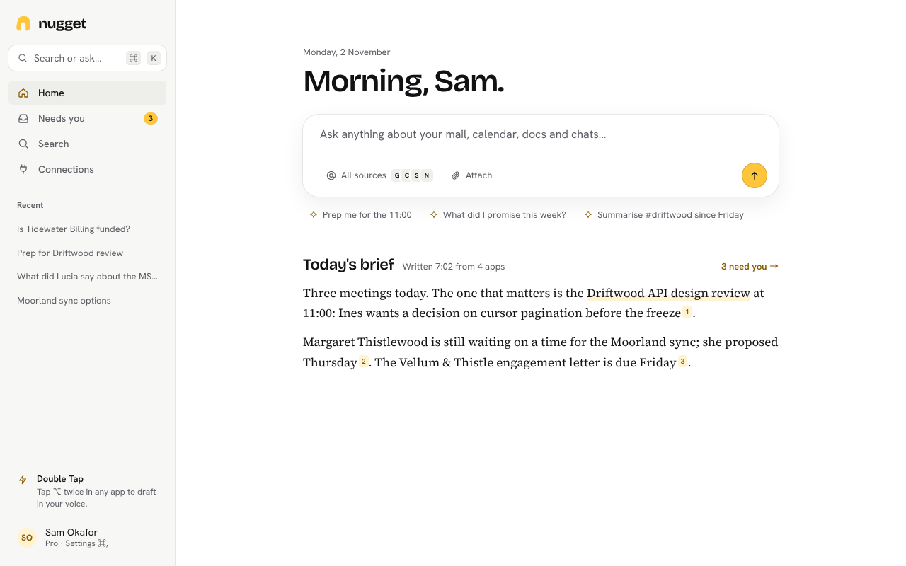
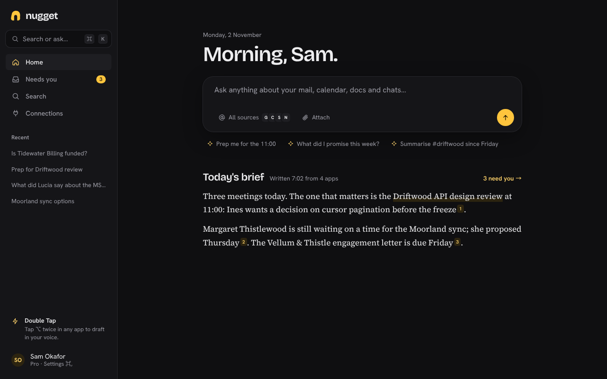
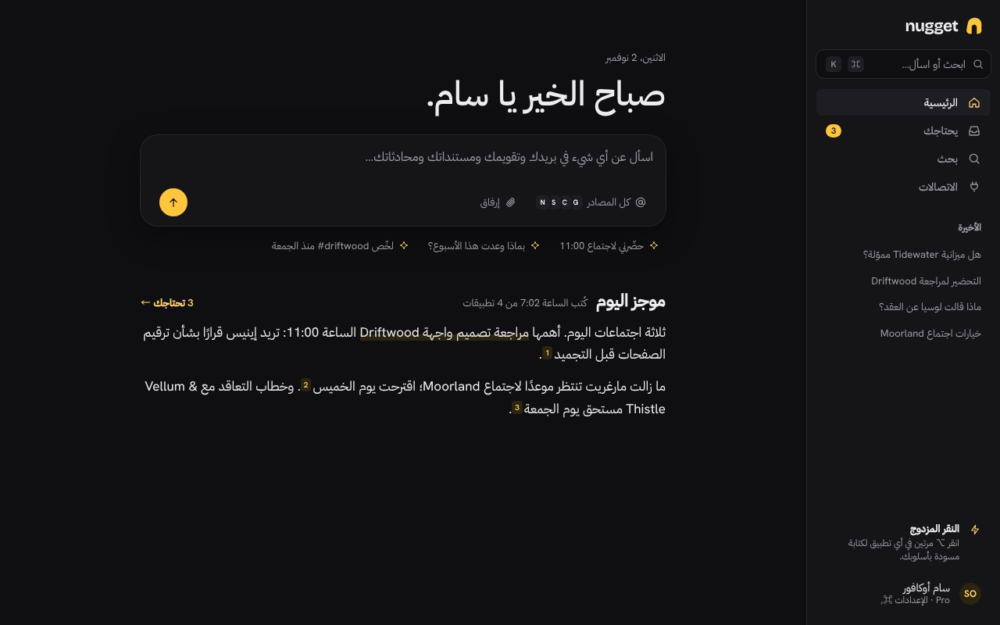
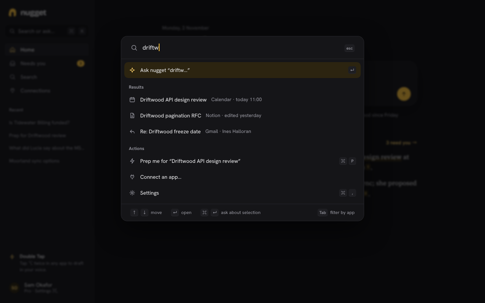
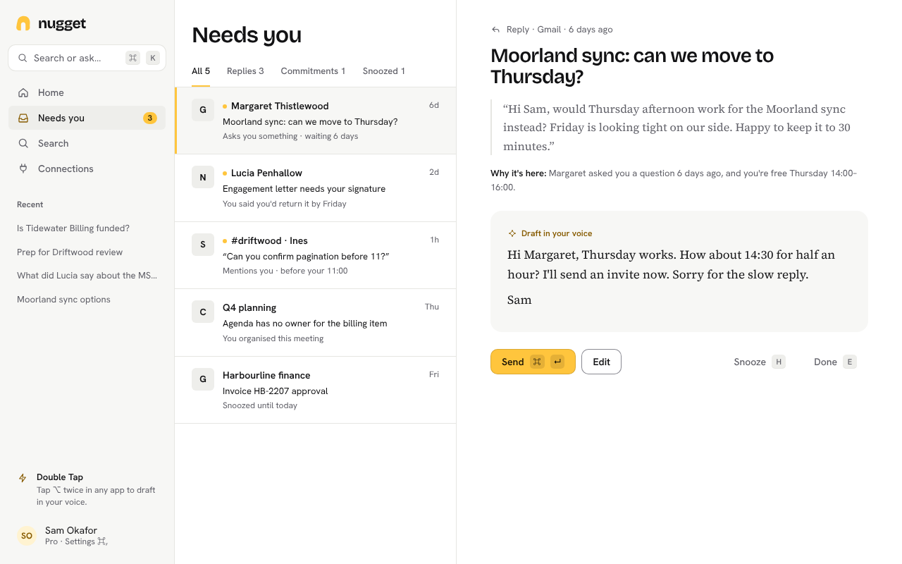
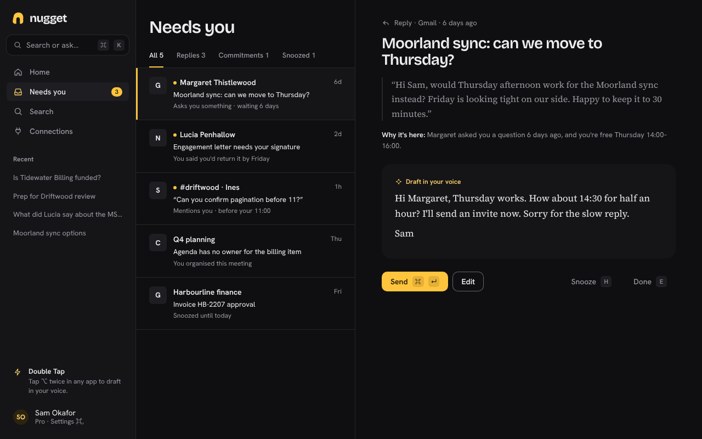
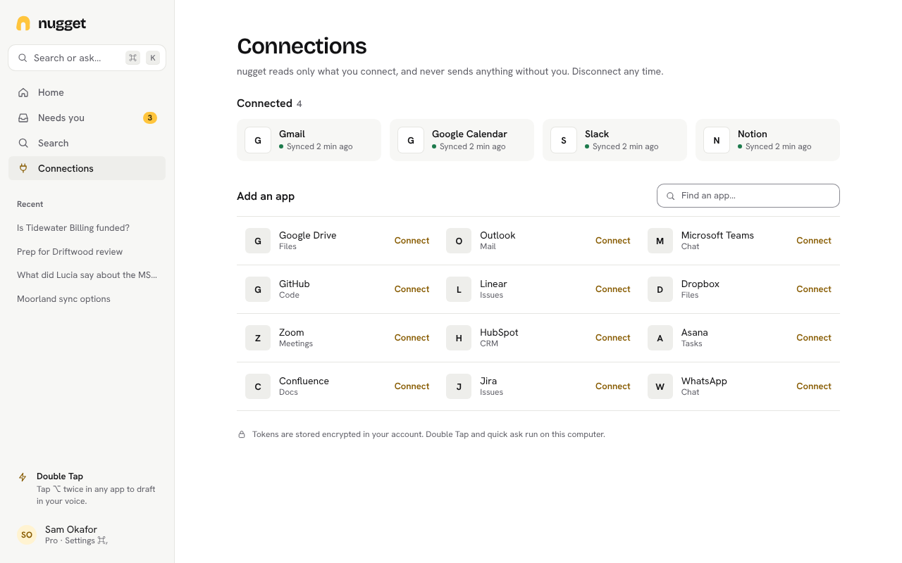
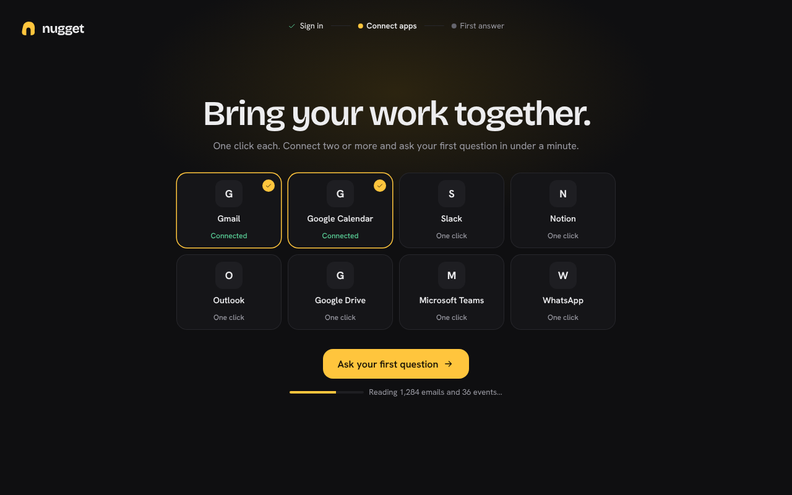
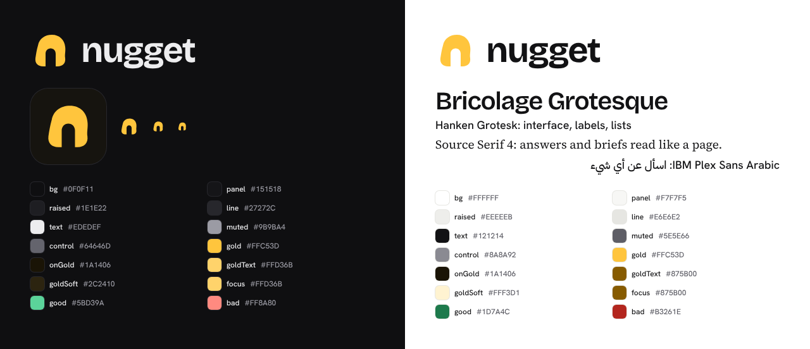

# nugget v2: concept mockups (not applied to the app)

This is for the cloud-first product. People sign in with an account, connect apps in one click
(Composio), and the AI runs in the cloud. Double Tap and quick ask stay on the desktop. The
mockups are real HTML and CSS, generated by `src/v2.mjs`, and show the component structure the
app would use. Nothing here touches `apps/`.

| Screen | Light | Dark |
| --- | --- | --- |
| Home (ask plus today's brief) |  |  |
| Home, Arabic RTL | |  |
| ⌘K command bar | |  |
| Needs you |  |  |
| Connections |  | |
| Onboarding, step 2 of 3 | |  |
| Brand sheet |  | |

## Information architecture

- **Four surfaces**, down from 13 sidebar items: Home, Needs you, Search and Connections. Under
  them sit the recent conversations, ChatGPT-style, then a Double Tap hint and the account menu.
  Settings live behind ⌘, or the account menu.
- **Home** puts the assistant at the centre: a greeting, a large composer that searches all sources
  (with the connected apps shown as small stacked tiles), three suggested questions, and then
  today's brief. The brief is written as two paragraphs of prose with citations, not as cards.
- **⌘K** does everything. Asking is the default row. Below it are results across apps, then
  actions, then navigation. Tab filters the results by app.
- **Needs you** works like an inbox: a dense list on one side and a reading pane on the other. The
  pane shows the quote, a single line saying why the item is here, and a draft in your voice. There
  is one gold primary action (Send ⌘↵), and keyboard shortcuts for Snooze (H) and Done (E).
- **Connections** shows the connected apps with their sync status, then a searchable, one-click
  catalogue. The app tiles are placeholder monograms: the real build would use the logos Composio
  provides. We draw no third-party brand art ourselves.
- **Onboarding** has three steps: sign in, connect apps, first answer. The connect step is the
  "event": large type, a gold glow, a grid of large tiles, and indexing progress shown live, so
  the first answer is ready within 60 seconds.

## Brand

- **Name.** "nugget" is set in lowercase, in Bricolage Grotesque Bold with tight tracking. The
  lowercase reads as friendly and confident, not corporate.
- **Logo.** A gold nugget whose negative space is a lowercase "n". It's one filled shape that
  holds up at 16 px. The app icon puts the gold mark on an ink tile.
- **Palette.** Dark mode is a first-class theme. Graphite neutrals are slightly cool, so the gold
  stands out. Gold `#FFC53D` is the only brand colour. It's used boldly but rarely: the mark, the
  one primary action per screen, the count badge, the selected row, citations and the caret. In
  light mode, gold used as text darkens to `#875B00`. Every pair passes WCAG AA, checked with
  `src/v2pal.mjs`. The lowest ratios are muted text at 5.5:1, controls at 3.1:1, and ink on gold at
  11.6:1.
- **Type.** All three typefaces are under the OFL and get bundled as woff2 files:
  - Bricolage Grotesque, for display and the wordmark: the personality.
  - Hanken Grotesk, for the UI: dense and neutral.
  - Source Serif 4, for answers and briefs, so they read like a well-set page.

  For other scripts: Arabic uses IBM Plex Sans Arabic, Devanagari uses Noto Sans and Serif
  Devanagari, and CJK falls back to the system fonts.
- **Shape and space.** The spacing scale is 4, 8, 12, 16, 24, 32, 48 and 64. The radius scale is 6,
  10, 16 and 22: the composer is the roundest and most important object. Separation comes from
  hairlines and whitespace, not boxes.
- **Motion.** Fast first, delight second:
  - Navigation and ⌘K are instant (120 ms opacity, and the palette scales from 0.98).
  - Lists enter with a 160 ms rise and fall.
  - Streamed answers fade in word by word.
  - A sent draft slides out over 200 ms while the next item is already focused.
  - Onboarding is the only place with a 400 ms flourish: the tiles "click in" and the gold glow
    breathes.
  - Easing is `cubic-bezier(.2,0,0,1)`. Nothing waits for an animation before taking input.
    `prefers-reduced-motion` turns all of it into instant opacity changes.
- **RTL.** Everything is built with logical properties, and the Arabic Home screen is rendered
  from the same CSS.

## Rebuilding the mockups

From `design/v2/src`, install the font packages with `npm i @fontsource-variable/bricolage-grotesque
@fontsource-variable/hanken-grotesk @fontsource-variable/source-serif-4 @fontsource/ibm-plex-sans-arabic`
into `src/fonts/` (that is, `cd fonts && npm i …`). Then run `node v2.mjs $PWD/../out && node
shoot.mjs $PWD/../out`.
