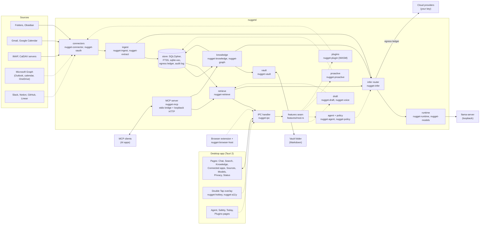

# Architecture overview

Nugget is one per-user daemon, `nuggetd`, and the apps that talk to it. The daemon owns the encrypted
store, the connectors, every model call and the MCP server. The desktop app holds the OS permissions
the daemon should not have (for Double Tap: accessibility and the global hotkey) and talks to the
daemon over the [local IPC protocol](../reference/ipc.md). The browser extension reaches the daemon
through a small native-messaging host, `nugget-browser-host`.

> **Status:** milestones M0 to M2 run in the daemon today: ingest, the encrypted store, local and
> bring-your-own-key models, search and Ask with citations, the knowledge graph and vault, and the MCP
> server. Double Tap, the agent and its safety policy, the browser bridge, proactive cards, plugins and
> the Microsoft 365 and SaaS connectors are being wired in (wave W). They are drawn with dashed lines
> below and are not available yet.

## Diagram

The diagram is a Mermaid chart. It renders on GitHub
([view it there](https://github.com/rayhankhilji/nugget/blob/main/docs/book/src/architecture/overview.md));
this book shows its source. Solid lines run today; dashed lines are being wired in (wave W).

## Walk-through

1. **Sources to connectors.** Each configured source in `sources.toml` gets a connector that turns it
   into a stream of upserts and deletes with versions. Files and Obsidian watch the file system; Gmail,
   Google Calendar, IMAP and CalDAV use the provider's own delta mechanism. Connectors never touch the
   store. OAuth sources use your own client through `nugget-oauth`.
2. **Ingest.** `nugget-ingest` runs one supervisor per source and a pipeline per change: extract,
   PII scan, optional local triage, chunk, embed, store. The cursor is saved only after everything
   before it is stored. See [Data flow](data-flow.md).
3. **Store.** One SQLCipher database holds items, chunks, the FTS5 and `sqlite-vec` indexes, the egress
   ledger, the hash-chained audit log and the knowledge-graph tables. The key is in the OS keychain.
4. **Knowledge.** After ingest commits, the daemon's knowledge task extracts entities and claims
   (every claim with an evidence quote), resolves entities and writes the graph. The vault re-renders
   the changed pages and merges your edits back. Changes go out as `knowledge.changed`.
5. **Retrieve.** Search and Ask use hybrid full-text and vector search with rank fusion and MMR, and
   pack passages under a token budget with `[n]` citations. Sensitive items are left out of anything
   sent to a cloud model.
6. **Models.** `nugget-infer` routes each request by capability tier to a local provider, the managed
   `llama-server` (installed from the signed manifest by `nugget-models`, supervised by
   `nugget-runtime`), or a cloud provider. Every non-local request writes an egress row.
7. **Serving.** The desktop app and the `nuggetd` CLI call the IPC handler. AI apps reach the
   [MCP server](../guide/mcp.md) over stdio (`nuggetd mcp --client <id>`, which relays over the same
   IPC socket) or streamable HTTP on 127.0.0.1, each with its own scoped token.
8. **Features (wave W).** New subsystems plug into `crates/nuggetd/src/features/`: one module each,
   with its own IPC methods, state, config section and shutdown, matched after the built-in methods.
   No feature is registered yet. Coming: Double Tap drafting, the agent with the policy engine and
   browser bridge, proactive cards and the morning brief, and WASM plugins. Their crates exist and are
   tested; the [crate map](crates.md) gives their state.

## Crates by layer

| Layer | Crates | Runs today |
|---|---|---|
| Contracts and plumbing | `nugget-core`, `nugget-ipc` | Yes |
| Storage | `nugget-store`, `nugget-graph` | Yes |
| Models | `nugget-infer`, `nugget-models`, `nugget-runtime` | Yes |
| Sources and ingest | `nugget-connector`, `nugget-oauth`, `nugget-extract`, `nugget-ingest`, `nugget-connector-files`, `nugget-connector-google`, `nugget-connector-imap`, `nugget-connector-caldav` | Yes |
| Knowledge | `nugget-knowledge`, `nugget-vault` | Yes |
| Serving | `nugget-retrieve`, `nugget-mcp` | Yes |
| Double Tap | `nugget-draft`, `nugget-voice`, `nugget-hotkey`, `nugget-a11y` | Being wired in |
| Agent and safety | `nugget-agent`, `nugget-policy`, `nugget-browser` | Being wired in |
| Proactive | `nugget-proactive` | Being wired in |
| Extensions and more sources | `nugget-plugin`, `nugget-connector-microsoft`, `nugget-connector-saas` | Being wired in |
| Binaries | `nuggetd`, `nugget-desktop`, `nugget-bench` | Yes |

Dependency rules that hold across crates: every crate depends on `nugget-core`; only `nuggetd` (and
the benchmark) depends on the M0 to M2 crates together; the desktop app depends only on `nugget-core`
and `nugget-ipc`, so it never opens the store or calls a model itself. Connectors depend on
`nugget-connector`, never on the store.
