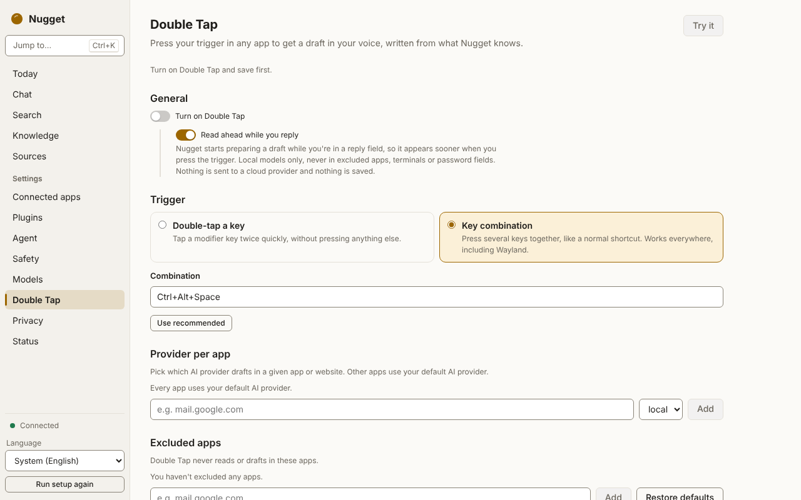

# Double Tap: drafting in your voice

> **Status:** Double Tap works in the desktop app: the trigger, the draft overlay at the caret and
> the **Double Tap** settings page. The daemon serves `draft.begin`, `draft.cancel`,
> `draft.feedback` and `voice.status`. Its latency targets are not yet measured in the shipped app
> (see [Latency](#latency)).

Put the cursor in a text field in any app, press the trigger, and Nugget drafts a reply in your own
writing style, grounded in passages from your own data. You see the draft before anything is
inserted.

## How it works

1. **The trigger.** By default a double tap of a modifier key: right Command on macOS, right Ctrl on
   Windows and Linux X11. On Wayland, where double taps cannot be observed, the default is the chord
   `Ctrl+Alt+Space`. You can choose any modifier for a double tap (with a window between 100 ms and
   2 s; 350 ms by default), or any chord.
2. **Reading the field.** The desktop app reads the focused field of the frontmost app through the
   OS accessibility API (macOS Accessibility, Windows UI Automation, Linux AT-SPI): the field's text,
   its role and label, and the conversation around it (the messages of a chat or the thread of an
   email, with subject and recipients). Only the focused window of the frontmost app is read. With
   [read-ahead](#read-ahead) on and a local model, this can happen a moment before the trigger,
   while the field has focus.
3. **Deciding what kind of field it is.** Fixed rules, not the model, decide whether the field is an
   email body, a chat composer, a comment, a document, a search box or a form field. Search boxes and
   other non-draftable fields are refused.
4. **Context.** The daemon retrieves passages related to the thread, subject and recipients and
   packs them into a budget (1 500 tokens by default), with citations. It does not send your whole
   vault, and it does not silently truncate.
5. **Voice.** Style statistics (length, greetings, sign-offs, formality, punctuation habits) and a
   few short examples of messages you wrote, chosen by recipient, then channel, then topic.
6. **The draft streams into an overlay** next to the caret. **Enter** accepts, **Tab** lets you edit,
   **Esc** cancels.
7. **Insertion.** Nugget inserts at the caret through the accessibility API and reads the field back
   to check the text arrived. If that is not possible, it pastes through the clipboard, saving and
   restoring every clipboard format, not just text.

Whether you accepted, edited or cancelled is recorded as feedback, so the voice profile can learn
from your edits.

## Your voice profile

The profile is built from messages **you** sent: sent mail (Gmail's `SENT` label, an IMAP Sent
folder), chat messages marked as yours, your Markdown notes and your feedback on earlier drafts.
Quoted replies and signatures are stripped first. "You" are recognised by the addresses and names you
configure, plus the most frequent `From` address of your sent mail. The profile is refreshed
incrementally as new items are indexed.

The settings page shows its status (from `voice.status`): how many of your messages it learned from,
per channel.

## Settings

On the **Double Tap** settings page:

| Setting | What it does |
|---|---|
| Trigger | The modifier to double-tap, or a chord |
| Provider per app | Which model to use in a given app or site, for example a local model in your work mail and a cloud model in a chat app. Otherwise the `synthesis` tier is used, like Ask |
| Excluded apps | Apps and sites where Double Tap never reads or drafts |
| Read ahead while you reply | Read a reply field early so a local model can start on it before the trigger. On by default; see [Read-ahead](#read-ahead) |

<picture>
  <source media="(prefers-color-scheme: dark)" srcset="../images/screenshots/double-tap-dark.png">
  
</picture>

## Read-ahead

A local model spends most of its time before the first word reading the prompt: the drafting rules,
your voice examples, the retrieved passages and the thread you are replying to. Read-ahead does that
reading while you are still looking at the thread, so after the trigger only what changed since (for
example the text you typed) is left to read, and the first character arrives much sooner.

**When it happens.** Double Tap is on, a text field keeps focus for about 1.5 seconds, the app is not
excluded and is not a terminal, and the field is not a password or other secure field. The desktop
app then reads the same context it would read at the trigger (the field's text, the visible thread,
recipients and subject) and asks the daemon (`draft.read_ahead`) to prepare the draft's prompt and
have the **local** model server read it into its cache. No text is generated and nothing is inserted.
While the field keeps focus it is read again at most every 10 seconds or so, and only if something
changed; the daemon also rate-limits read-aheads (one every 5 seconds by default). When focus leaves
the field, the pending read-ahead is cancelled (`draft.read_ahead_cancel`).

**Where it goes.** Only to the model server on your machine (or a local-network server you
configured as the provider, which the egress ledger records), and only when that is the provider the draft would use. If the draft
would go to a cloud provider, nothing is read ahead and nothing is sent until you press the trigger.
The prepared prompt lives only in that server's in-memory cache (and briefly in the daemon's
in-memory retrieval cache); nothing is written to disk or to your store.

**What it costs.** Some CPU (and battery on a laptop) while focus moves between text fields: each
read-ahead makes the local model read a prompt of several hundred tokens. Measured on a 2-core
cloud CPU, that is about 15 CPU-seconds per newly focused reply field with the 4B model, 8 with
the 1.7B. When you then draft, the draft skips that same reading, so it mostly moves work rather
than adding it; it is wasted only for fields you focus and don't draft in. See [Latency](#latency).

**Turning it off.** Switch off **Read ahead while you reply** on the Double Tap page. To turn it off
for every client of the daemon, set `enabled = false` under `[draft.read_ahead]` in `config.toml`
(see [Configuration](../reference/config.md#draft)).

## A smaller model for Double Tap

Double Tap normally drafts with the same model as Ask (the `synthesis` tier). A smaller model reads
prompts several times faster on a CPU. To use one for local Double Tap drafts only, name it in
`config.toml`:

```text
[draft.local]
model = "<model id from the manifest>"
```

The daemon then runs that model in a separate local server, shown on the Status page with the role
**Double Tap drafts**. Drafts that go to a local model by default (not through a provider you
chose for an app) try it first and fall back to the chat model if it is not available; Ask, chat
and drafts with a cloud provider are unchanged.

The manifest has a small model for this, `qwen3-1.7b-q8`: on slower computers it starts drafting
two to three times as fast as the default 4B model. In the drafting test its voice match was a
little weaker and its facts were at least as accurate (see the
[benchmarks](https://github.com/rayhankhilji/nugget/blob/main/bench/README.md)). The setting
accepts any chat model in the manifest. An even smaller model, `qwen3-0.6b-q8`, was measured and
is not offered: its drafts recalled too few of the facts they needed.

## What it will not do

- **It never reads password or secure fields.** The accessibility layer reports such a field as
  secure without reading its value, and the drafting engine refuses it (password, one-time code and
  card number fields).
- **Excluded apps are never read.** By default this covers password managers and keychains
  (1Password, Bitwarden, LastPass, Dashlane, KeePass and others), banking, payment and brokerage apps
  and sites, and system settings. In an excluded app no thread, recipients, subject or field text is
  read, and nothing is inserted. You can add more.
- **It does not send by itself.** It inserts text into the field; you press Send.
- **It does not read ahead for cloud models.** [Read-ahead](#read-ahead) only ever goes to a local
  model server, never in excluded apps, terminals or secure fields, and stores nothing.
- **It does not record keystrokes.** For a double tap only modifier presses are observed; for every
  other key the listener learns only that *some* key was pressed (which cancels a tap that was part of
  a shortcut). A chord is registered with the OS, which reports only that chord. No key, key code or
  text is ever logged.

## Privacy

What leaves the device depends on the provider used for the draft:

- **Local or local-network model:** nothing leaves your machine (a local-network request is still
  recorded in the [egress ledger](privacy.md)). With read-ahead on, the field's context is read and
  sent to that local server a moment before the trigger; see [Read-ahead](#read-ahead).
- **Cloud model:** the field text, the thread read around it, the subject and recipients, the
  retrieved passages and your voice examples are sent to that provider. **Sensitive items are never
  included**: they are left out of the passages and the examples, and the engine refuses outright if
  a sensitive passage would still reach a cloud model. Each request is recorded in the egress ledger
  with feature `draft` and the items whose content was included.
- **Screenshots** are used only when no text thread could be read, only with a vision-capable model,
  and only with a local one unless you allow cloud screenshots (off by default).

Text read from other apps is treated as untrusted data in the prompt, never as instructions. Every
draft is audited without its content.

## Permissions per OS

| OS | What to allow |
|---|---|
| macOS | Accessibility for the Nugget app (reading fields and inserting). A double tap needs no extra permission; the kill switch's Escape counter needs Accessibility too |
| Windows | Nothing extra |
| Linux | Accessibility (AT-SPI) enabled in your desktop. On Wayland, use a chord: the trigger goes through the desktop's global-shortcuts portal |

## Latency

The targets are a first inserted token in under 1.2 s (median) with a cloud provider and under 3 s
with a local 4B-class model on a 16 GB machine. To get there, Nugget starts warming the provider,
retrieval and the voice lookup as soon as the trigger fires, and with a local model it can
[read ahead](#read-ahead) before the trigger and draft with a [smaller model](#a-smaller-model-for-double-tap). These targets are measured by the
`draft` benchmark suite (see [Benchmarks](../architecture/benchmarks.md)); they are not yet measured
in the shipped app.

Measured with real local models on GitHub's runners (2-core cloud CPUs and virtual Apple M1 and M2
Pro machines), from the trigger to the first inserted character, median: with the 4B model 10–30 s
without read-ahead and **0.1–0.6 s with read-ahead** once the read-ahead has finished; with the 1.7B,
3–15 s without and 0.1–0.2 s with. The read-ahead itself needs the field to keep focus for a while
first: 6–21 s with the 4B, 4.5–11 s with the 1.7B, depending on the machine. A trigger pressed
before the read-ahead finishes waits for the rest of it; that case has not been measured yet. The details are in the
benchmark results (`bench/README.md`, "Real-model results").
