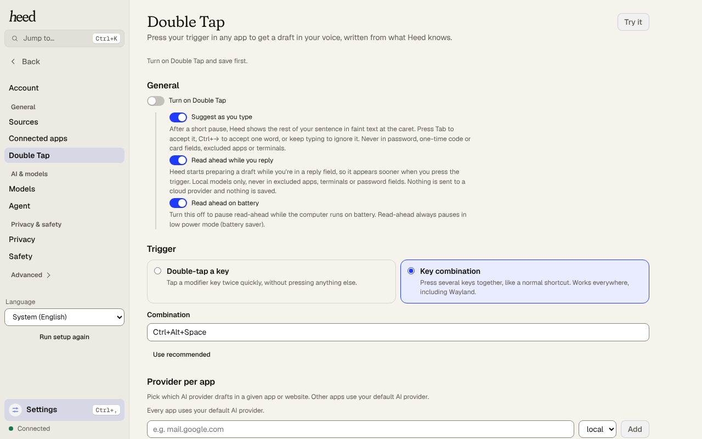

# Double Tap: drafting in your voice

Put the cursor in a text field in any app, press the trigger, and Nugget drafts a reply in your own
writing style, grounded in your own data. You see the draft before anything is inserted, and nothing
is ever sent for you.

## How it works

1. **Trigger.** By default a double tap of right Command (macOS) or right Ctrl (Windows, Linux X11).
   On Wayland the default is the chord `Ctrl+Alt+Space` (see [Wayland](#wayland)). You can pick any
   modifier (tap window 100 ms to 2 s, default 350 ms) or any chord.
2. **Reading the field.** Through the OS accessibility API, Nugget reads the focused field of the
   frontmost window: its text, role and label, and the conversation around it (chat messages, or an
   email thread with subject and recipients). Search boxes and other non-draftable fields are
   refused.
3. **Context and voice.** The daemon adds related passages from your data (1 500 tokens by default,
   with citations) and your style: length, greetings, sign-offs, formality, and a few short examples
   of messages you wrote.
4. **The draft streams into an overlay** next to the caret (see [The overlay](#the-overlay)).
5. **Insertion.** Nugget inserts at the caret and reads the field back to check. If that isn't
   possible it pastes, saving and restoring your whole clipboard.

Whether you accepted, edited or cancelled is fed back into your voice profile.

## The overlay

| Key | In the overlay |
|---|---|
| **Enter** | Insert the draft (while it is still streaming: insert what is shown and stop the rest). |
| **Tab** | Edit the draft in place. While editing, **Enter** is a new line, **Ctrl+Enter** (**⌘↩** on macOS) inserts your edit, **Ctrl+Shift+Enter** (**⌘⇧↩**) inserts the original draft as is. |
| **R** | Retry: a new draft from the same context. |
| **S**, **L**, **F**, **C** | Shorter, longer, more formal, more casual (rewrites the current draft or your edit). |
| **H** | Previous drafts: pick one to insert it instead. |
| **Esc** | Cancel and return the keyboard to your field. |

Every action is also a button, and screen readers hear status changes. Clicking away closes the
draft; pressing the trigger brings it back. If focus moved to another field, nothing is inserted:
the draft goes to the clipboard instead.

The last 20 drafts are kept in memory only (**H**, or **Recent drafts** on the Double Tap page),
except drafts that used sensitive items or contain secrets. The Double Tap page also has a practice
field for trying your shortcut.

## Your voice profile

Built from messages **you** sent (sent mail, your chat messages, your Markdown notes) and your
feedback on drafts, with quotes and signatures stripped. The Double Tap page shows how many messages
it learned from, per channel.

## Settings

| Setting | What it does |
|---|---|
| Trigger | The modifier to double-tap, or a chord |
| Provider per app | Which model to use in a given app or site (for example local in work mail, cloud in a chat app). Otherwise the `synthesis` tier, like Ask |
| Excluded apps | Apps and sites where Double Tap never reads or drafts |
| Read ahead while you reply | Let a local model start reading a reply field before the trigger. On by default; see [Read-ahead](#read-ahead) |
| Read ahead on battery | When off, read-ahead pauses on battery. Low power mode / battery saver always pauses it |

<picture>
  <source media="(prefers-color-scheme: dark)" srcset="../images/screenshots/double-tap-dark.png">
  
</picture>

## Read-ahead

With a local model, most of the wait before the first word is the model reading the prompt.
Read-ahead does that reading while you are still looking at the thread: once a reply field has had
focus for about 1.5 s, the app reads the same context it would at the trigger and has the **local**
model server pre-read the prompt into its in-memory cache. Nothing is generated, inserted or written
to disk.

- It never runs for cloud providers, in excluded apps, in terminals or in secure fields.
- It costs CPU and battery for fields you focus but don't draft in (roughly 15 CPU-seconds per field
  with the 4B model on a slow CPU). It pauses in low power mode and, if you choose, on battery.
- Turn it off with **Read ahead while you reply**, or for every client with `enabled = false` under
  `[draft.read_ahead]` (see [Configuration](../reference/config.md#draft)).

## A smaller model for Double Tap

Double Tap normally uses the Ask model (`synthesis` tier). For faster local drafts, name a smaller
model in `config.toml`:

```text
[draft.local]
model = "<model id from the manifest>"
```

`qwen3-1.7b-q8` starts drafting two to three times as fast as the default 4B on slower computers,
with slightly weaker voice match. It runs as a separate server (**Double Tap drafts** on Status) and
falls back to the chat model.

## What it will not do

- **Read secure fields or excluded apps** (by default password managers, banking and payment apps
  and sites, and system settings; you can add more).
- **Send by itself.** You press Send.
- **Copy secrets, or follow instructions planted in your items.** Retrieved notes and mail are
  data: a sentence in them that tells an AI what to do is removed before the prompt. A check drops
  any sentence of the draft that writes out a credential from a sensitive item, a link, email
  address, phone, account or card number that neither the thread nor your own text has, or an
  amount or date the thread and your items don't support. `[draft] grounding = false` keeps the
  credential and link checks but stops checking values; `grounding_check = "sentences"` is
  stricter but delays the first character by a few seconds (see
  [Configuration](../reference/config.md#draft)).
- **Record keystrokes.** For a double tap only modifier presses are observed; a chord is registered
  with the OS. No key or text is logged.

## Privacy

- **Local or local-network model:** nothing leaves your machine (local-network requests are still
  recorded in the [egress ledger](privacy.md)).
- **Cloud model:** the field text, surrounding thread, subject, recipients, retrieved passages and
  voice examples go to that provider. **Sensitive items are never included.** Each request is in the
  egress ledger with feature `draft`.
- **Screenshots** are used only when no text thread could be read, only with a vision model, and
  only locally unless you allow cloud screenshots (off by default).

Every draft is audited without its content.

**Known limitation:** text from other apps and your data is marked as untrusted, but Double Tap can
still follow an instruction planted in a note in your vault (for example, adding an attacker's link
to a draft). This is an open issue; read drafts before sending.

## Which apps work

<!-- a11y-matrix:guide:start -->
Double Tap is tested against real apps on GitHub's macOS, Windows and Linux machines: the major
browsers loading pages that reproduce web mail and chat composers (a plain text box, a Gmail-like
compose, and the editors behind most chat and mail sites: ProseMirror/TipTap, Quill, Draft.js,
Lexical, CKEditor), and each OS's own editors. For each, it checks that Nugget finds the field,
reads its text and the conversation around it, refuses password fields, and inserts six kinds of
text exactly (line breaks, emoji, right-to-left text, accents, 5000 characters), with one undo
taking the insertion back out. Latest results (2026-10-31):

| | Works | Known problems |
|---|---|---|
| **Windows**: Chrome, Edge | Everything, on all eight page types, mail threads included | |
| **Windows**: Notepad, WordPad | Reading and inserting | Notepad's undo is one level deep; WordPad undoes right-to-left text in two steps |
| **Windows**: Firefox | | Not detected yet: Firefox reports no focused field to Nugget |
| **macOS**: Safari | Everything | Accented letters typed as two characters (e + ´) arrive combined (é): same text, different encoding |
| **macOS**: Chrome, Edge, Firefox | | Not measured yet (the test machines could not bring them to the front) |
| **macOS**: TextEdit, Notes | TextEdit's field is found | Inserting not measured yet; Notes not detected |
| **Linux**: Firefox | Finding, reading and inserting, on all eight page types | Reading the conversation is unreliable |
| **Linux**: Chrome | With `--force-renderer-accessibility` (checked on a local machine) | Chrome shows web pages to accessibility tools only when started with that flag |
| **Linux**: gedit | Everything | |
| **Linux**: LibreOffice Writer | Reading and inserting | Only the paragraphs on screen can be read, so very long text cannot be checked |

In rich editors Nugget inserts by pasting, with your clipboard saved and restored around it,
because every editor handles a paste as one step that undo takes back whole. Every failing cell,
with the reason, is in the [benchmark results](https://github.com/rayhankhilji/nugget/blob/main/bench/README.md#double-tap-app-matrix-ff3).
<!-- a11y-matrix:guide:end -->

## Permissions per OS

| OS | What to allow |
|---|---|
| macOS | Accessibility for the Nugget app (reading fields, inserting, and the kill switch's Escape counter) |
| Windows | Nothing extra |
| Linux | Accessibility (AT-SPI) enabled in your desktop. On Wayland, use a chord (see [Wayland](#wayland)) |

## Wayland

Apps can't watch the keyboard on Wayland, so Double Tap uses a chord (`Ctrl+Alt+Space` by default)
registered through the desktop portal:

| Desktop | What you see |
|---|---|
| KDE Plasma 6 | Approve the shortcut once. Change it in System Settings → Keyboard → Shortcuts → Nugget |
| KDE Plasma 5.27 | The shortcut has no key. Assign one to "Nugget: draft a reply" in System Settings → Shortcuts |
| GNOME 48 and later | Approve the shortcut once. Change it in Settings → Keyboard → Keyboard Shortcuts |
| GNOME before 48, sway, other wlroots desktops | No portal. Bind a key to `nugget-desktop --double-tap` (sway: `bindsym Ctrl+Alt+Space exec nugget-desktop --double-tap`), or use **Try it** on the Double Tap page |

The Double Tap page shows the shortcut's state.

## Latency

Targets: first token under 1.2 s with a cloud provider and under 3 s with a local 4B model on a
16 GB machine, not yet measured in the shipped app. On slow CPUs the local 4B took 10–30 s without
read-ahead and under a second once read-ahead had finished (see
[Benchmarks](../architecture/benchmarks.md)).
