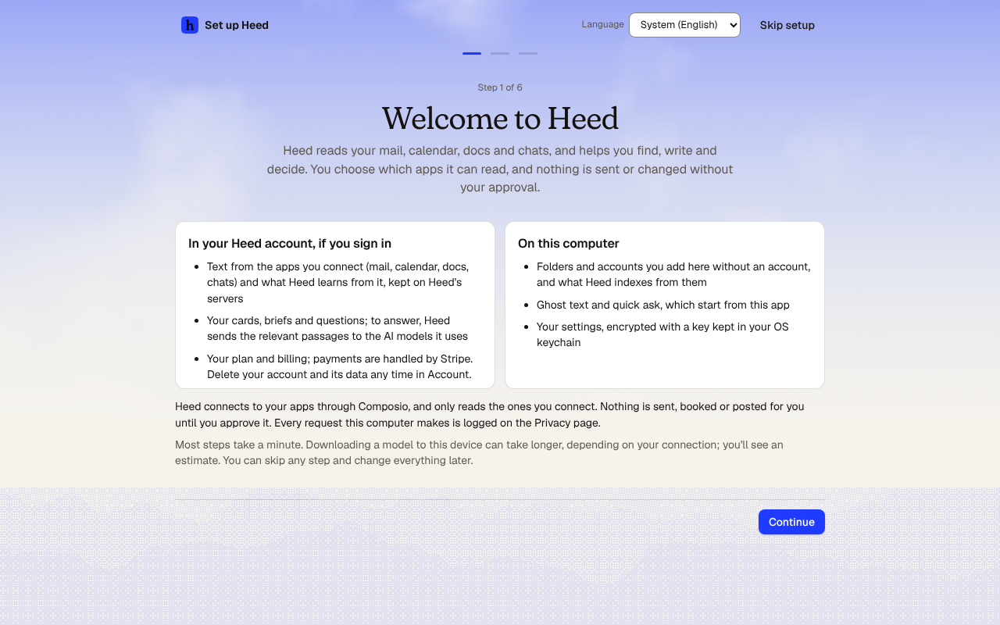
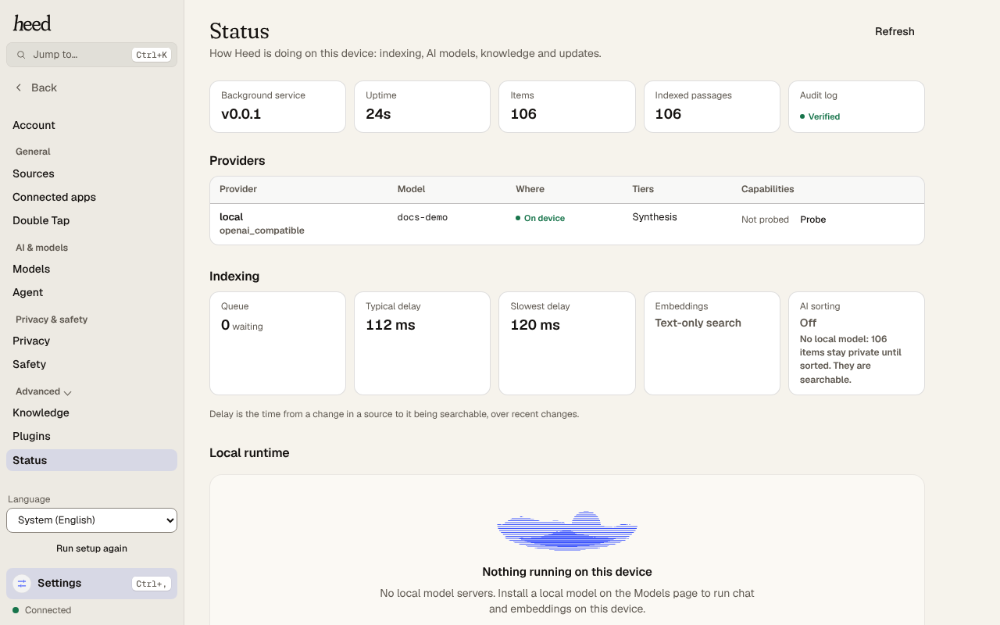

# First run

The first time `nuggetd` starts, it does the following, all locally:

1. **Finds its directories**: your OS's per-user data, config and cache directories, or one folder
   given by `NUGGET_HOME` or `--home DIR` (see [Data directory](../reference/data-dir.md)).
2. **Writes a default `config.toml`** if there is none. The only provider is an Ollama server on
   `127.0.0.1`; no cloud provider is enabled. See [`config.toml`](../reference/config.md).
3. **Creates the store's encryption key** and keeps it in your OS keychain. Without a usable keychain
   (for example a headless Linux server) it falls back to a `store.key` file readable only by you, and
   logs a warning.
4. **Opens the encrypted store** (`nugget.db`) and verifies the audit log's hash chain.
5. **Listens locally only**: a Unix socket in a private directory (a named pipe on Windows), plus
   `127.0.0.1:7319` for [MCP](mcp.md), where every request needs a client token.
6. **Starts the knowledge pipeline**, which renders people, organisations and facts into
   `~/Nugget Vault` (see [The knowledge graph and vault](knowledge.md)).

Nothing leaves your machine. Check with `nuggetd status`:

```text
$ nuggetd status
nuggetd 0.0.1 running (protocol 1), up 12s
socket:    /home/you/.local/share/nugget/ipc/nuggetd.sock
store:     0 items, 0 chunks
audit:     chain verified
providers:
  local  openai_compatible qwen3:4b  on-device  tiers: triage, light, synthesis  not probed
```

## In the desktop app

The first launch opens a short setup: Welcome, Choose your AI, First source, Permissions and
Double Tap. Every step can be skipped; **Run setup again** in the sidebar brings it back.

<picture>
  <source media="(prefers-color-scheme: dark)" srcset="../images/screenshots/welcome-dark.png">
  
</picture>

Then:

1. **Status** shows the daemon; if it is not running, the app offers to start it.
2. **Models**: pick models ([Local or bring-your-own-key](models.md)). A badge marks the best fit for
   your machine's memory.
3. **Sources**: add a folder, an Obsidian vault or an account ([Adding sources](sources.md)). Items
   are searchable as soon as they are indexed; you don't wait for the whole backfill.
4. **Search** and **Ask a question** ([Search and Ask](search-ask.md)).
5. **Knowledge** shows the people, organisations and facts found so far; **Connected AI apps** lets
   Claude Desktop, Claude Code or Cursor read them over [MCP](mcp.md).

<picture>
  <source media="(prefers-color-scheme: dark)" srcset="../images/screenshots/status-dark.png">
  
</picture>

The sidebar also has [Today](today.md), [Double Tap](double-tap.md), [Agent](agent.md),
[Safety](safety.md) and [Plugins](plugins.md).

The target is a useful search result within two minutes of first launch, with backfill continuing in
the background. See [Benchmarks](../architecture/benchmarks.md) for indexing speed.
