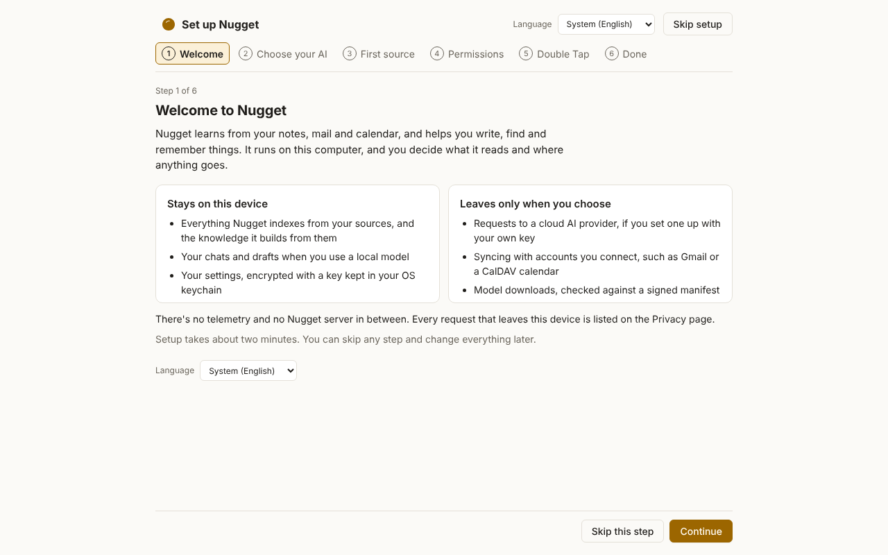
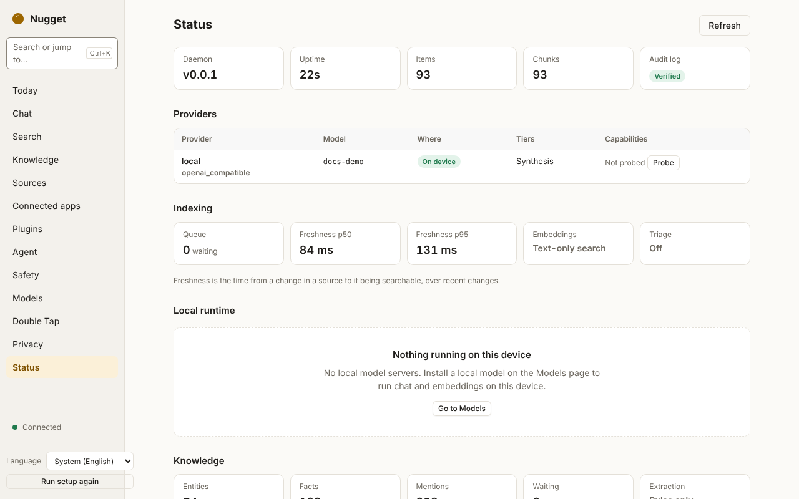

# First run

The first time `nuggetd` starts, it does the following, all locally:

1. **Finds its directories.** By default it uses your OS's per-user data, config and cache
   directories. `NUGGET_HOME` or `--home DIR` puts all three under one folder instead. See
   [Data directory](../reference/data-dir.md).
2. **Writes a default `config.toml`** if there is none, and says where it wrote it. The default is
   local-first: the only provider is an Ollama server on `127.0.0.1`, and no cloud provider is enabled.
   See [`config.toml`](../reference/config.md).
3. **Creates the encryption key** for the store: 256 random bits, kept in your OS keychain (macOS
   Keychain, Windows Credential Manager or the Secret Service on Linux). If no keychain is usable, for
   example on a headless Linux server, it falls back to a `store.key` file readable only by you, and
   logs a warning.
4. **Opens the encrypted store** (`nugget.db`), and checks the audit log's hash chain in the
   background.
5. **Starts listening** on a local socket: a Unix socket in a private (`0700`) directory, or a
   per-user named pipe on Windows. For [MCP](mcp.md) it also listens on `127.0.0.1` port 7319
   (loopback only; every request needs a client token). There is no listener reachable from
   the network.
6. **Starts the knowledge pipeline.** Once items are indexed, it extracts people, organisations and
   facts and renders them into the vault folder, `~/Nugget Vault` by default. See
   [The knowledge graph and vault](knowledge.md).

Nothing leaves your machine at this point. Run `nuggetd status` to check:

```text
$ nuggetd status
nuggetd 0.0.1 running (protocol 1), up 12s
socket:    /home/you/.local/share/nugget/ipc/nuggetd.sock
store:     0 items, 0 chunks
audit:     chain verified
providers:
  local  openai_compatible qwen3:4b  on-device  tiers: triage, light, synthesis  not probed
```

## In the desktop app

The first launch opens a short setup: Welcome, Choose your AI, First source, Permissions and
Double Tap. You can skip any step, and **Run setup again** in the sidebar brings it back.

<picture>
  <source media="(prefers-color-scheme: dark)" srcset="../images/screenshots/welcome-dark.png">
  
</picture>

After setup, or to check on things later:

1. Open **Status**. If the daemon is not running, the app offers to start it.
2. Open **Models** and pick models: [Local or bring-your-own-key](models.md) explains the choice.
   A recommended badge marks the best fit for your machine's memory.
3. Open **Sources** and add a folder, an Obsidian vault, or an account. See
   [Adding sources](sources.md).
4. Watch the **Indexing** widget. Items become searchable as they are indexed; you do not have to
   wait for the whole backfill.
5. Try **Search**, then **Ask with context**. See [Search and Ask](search-ask.md).
6. Open **Knowledge** to see the people, organisations and facts found so far, and
   **Connected AI apps** to let Claude Desktop, Claude Code or Cursor read them over
   [MCP](mcp.md).

<picture>
  <source media="(prefers-color-scheme: dark)" srcset="../images/screenshots/status-dark.png">
  
</picture>

The sidebar also has **Today** ([Today](today.md)), **Double Tap** settings
([Double Tap](double-tap.md)), **Agent** ([The agent](agent.md)), **Safety** ([Safety](safety.md))
and **Plugins** ([Plugins](plugins.md)).

## Time to first value

The target is a useful search result in under two minutes from first launch, with backfill
continuing in the background. The desktop end-to-end test measures it: its first-run scenario runs the
real daemon from an empty home and the real app through setup to a first search result, against a
budget of 120 s. The current figure is measured in CI by `pnpm run e2e` (see
`apps/desktop/e2e/README.md`).

Indexing on its own: on a 4-vCPU cloud VM, a 5 000-file Markdown folder indexed in 25.5 s, and a
change to a watched file became searchable in 0.6 s at the 95th percentile. See
[Benchmarks](../architecture/benchmarks.md) for the conditions, which use a test embedder, not a real
model.
