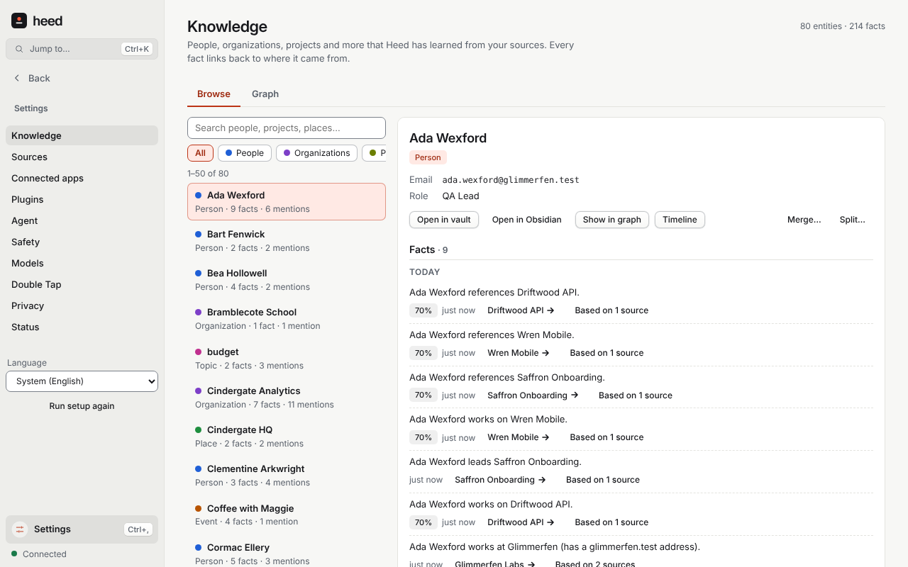
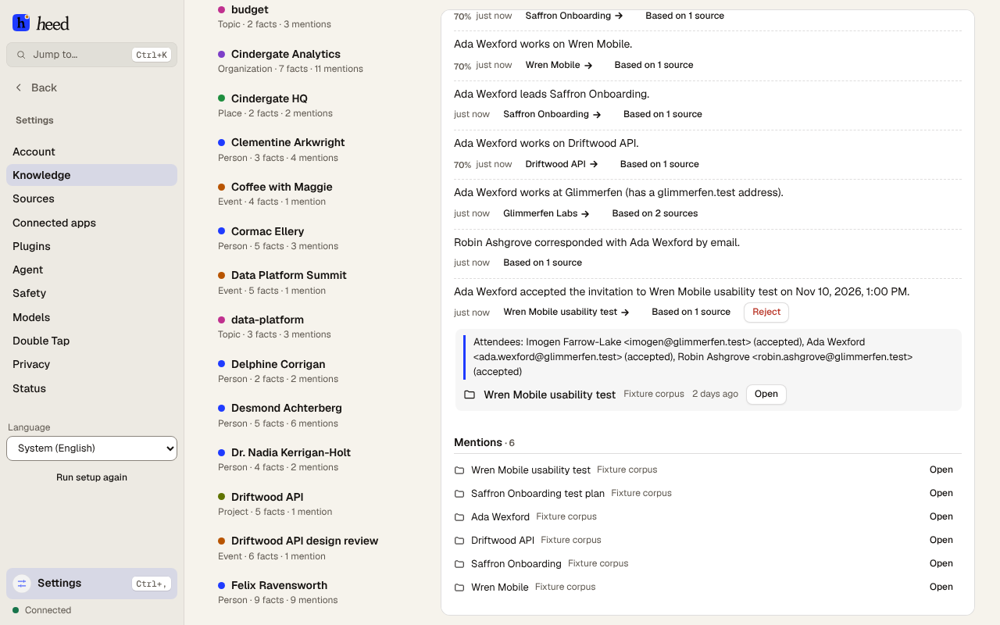
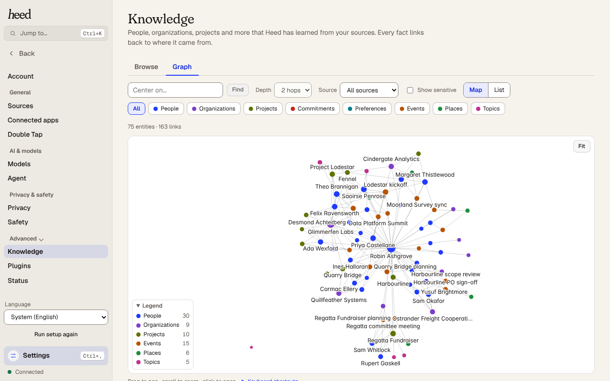

# The knowledge graph and vault

Search finds passages. The knowledge graph remembers **who and what** they are about: people,
organisations, projects, commitments, preferences, events, places and topics, and the facts linking
them. Every fact points back to the passages it came from.

**Entities** have a kind, name, aliases, identifiers (emails, phone numbers) and a stable id that
survives merges; you are one too (`is_me`). **Facts** ("Sam works at Acme") carry a confidence and
**evidence**: the item and a short quote. Only facts you wrote yourself may lack evidence.
**Mentions** record every place an entity appears.

## How facts are extracted

Extraction runs at startup, shortly after indexing changes, and every 10 minutes (no LLM requests
on low battery). `enabled = false` under `[knowledge]` turns it off; see
[`config.toml`](../reference/config.md#knowledge).

1. **Deterministic extractors** (always on) read mail headers, calendar events, Markdown tags,
   frontmatter and wikilinks, and contacts.
2. **An optional LLM extractor** (`synthesis` tier, local only by default) must quote the source
   **verbatim** for every fact, or the fact is dropped.
3. **Entity resolution** merges mentions by identifiers, then names and aliases, never across
   conflicting identifiers.

Cloud extraction is opt-in per source (`cloud_sources` under `[knowledge.llm]`), never for sensitive
or unclassified items, and logged in the [egress ledger](privacy.md) as `knowledge`. Set your name
and addresses under `[knowledge.me]`; otherwise Nugget infers you from your sent mail. Edited items
are re-extracted; facts that relied only on a deleted item are retracted.

## The vault

The graph is rendered as Markdown pages (`<Kind>/<Name> (<short id>).md`, plus a `README.md` index)
you can read in any editor, including Obsidian. The folder is `~/Nugget Vault` (or `vault` in the data
directory with `--home` or `NUGGET_HOME`); `path` under `[vault]` moves it. Pages re-render after each
extraction run, and the folder is watched for your edits. A page, without the invisible HTML comments
that mark Nugget's regions (leave those in place):

```markdown
# Samantha Lee
## Facts
### Works at
- Samantha works at [[Organization/Acme (ent_000002)|Acme]]. [^1]

[^1]: [Lunch on Friday](https://mail.example/1): "Sam from Acme"
## Notes
```

Links include the short id, so renames don't break them. Email addresses and phone numbers are kept
out of pages, since the vault is plain text you may sync elsewhere.

### Sensitive items and the vault

Nothing from an item confirmed [sensitive](privacy.md#sensitive-items) (by the scan, a sensitivity
rule, or local triage) is written to the vault. Items not yet triaged are shown like any other and
leave the vault if later confirmed sensitive.

Facts sourced only from sensitive items, and aliases learned only from them, are left out;
footnotes never cite them; an entity known only from them gets no page (a page you wrote notes on is
kept as "Hidden page" with only your text). They stay in the encrypted store, badged **Sensitive** on
the **Knowledge** page, hidden from the graph view unless you turn on **Show sensitive**, and from MCP
clients unless allowed.

## Editing the vault

The encrypted store stays the source of truth; your edits are merged back with a three-way merge:

| You do this | Nugget does this |
|---|---|
| Write outside the generated regions (for example under `## Notes`) | Keeps it on every re-render |
| **Edit** a fact line | The old fact becomes `superseded`; your text becomes a `user_asserted` fact, marked `(you)` |
| **Delete** a fact line | The fact becomes `rejected` and is never re-extracted |
| **Add** a bullet under a fact heading | A new `user_asserted` fact with that relation |
| Add an alias in the frontmatter | The alias is added to the entity |
| Change a region Nugget also changed | Your version is kept; Nugget's goes to `.nugget/conflicts/` |

If an editor strips the HTML comments, Nugget restores them from the last render. A render never
overwrites an edit you just made. For a single-valued fact (such as an employer), your value stays
until a source dated after your edit says otherwise.

## Fact statuses

| Status | Meaning |
|---|---|
| `active` | A current fact, backed by evidence |
| `user_asserted` | A fact you wrote or edited; needs no source |
| `superseded` | Replaced by a newer fact or by your edit |
| `retracted` | Lost its evidence: its sources changed or were deleted |
| `rejected` | Rejected by you. Sticky: re-extraction never revives it; only restoring it, or asserting it yourself, does |

Deleting a fact line in the vault or rejecting a fact on the **Knowledge** page sets `rejected`
(with a brief **Undo**). Over IPC, `knowledge.claim.status` sets and reports it.

## In the desktop app

The **Knowledge** page lists entities and their facts; **Based on N sources** opens a fact's
evidence. Merge duplicates, reject facts, open vault pages, and see how many items await extraction.
The **graph view** draws an entity's neighbourhood. `knowledge.status` also reports the last run, the
extraction model, and vault pages with errors or conflicts.

<picture>
  <source media="(prefers-color-scheme: dark)" srcset="../images/screenshots/knowledge-dark.png">
  
</picture>

<picture>
  <source media="(prefers-color-scheme: dark)" srcset="../images/screenshots/knowledge-why-dark.png">
  
</picture>

<picture>
  <source media="(prefers-color-scheme: dark)" srcset="../images/screenshots/graph-dark.png">
  
</picture>

Over IPC: [`knowledge.*`](../reference/ipc.md#knowledge-graph), with `knowledge.changed`
notifications. Over [MCP](mcp.md): `find_entities`, `get_entity` and `get_neighbourhood` (see
[MCP tools](../reference/mcp.md)).
