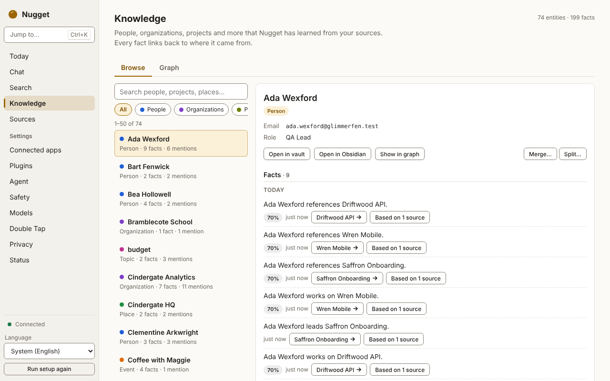
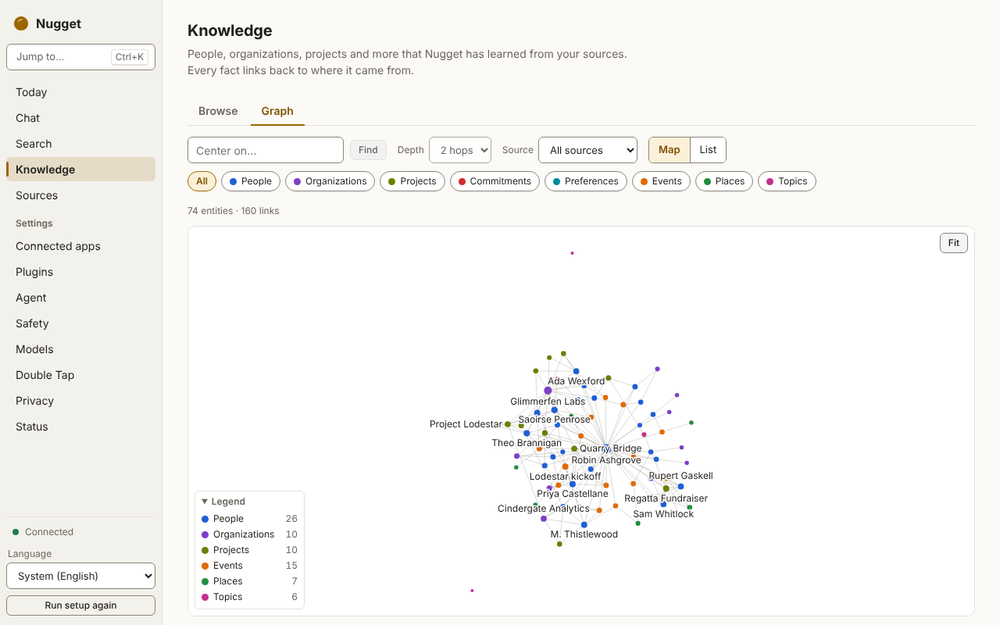

# The knowledge graph and vault

Search finds passages. The knowledge graph remembers **who and what** those passages are about: people,
organisations, projects, commitments, preferences, events, places and topics, and the facts that link
them. Every fact points back to the passages it came from.

## What is in the graph

- **Entities** have a kind, a name, aliases, identifiers (email addresses, phone numbers) and a
  **stable id** that is never reused. When two entities are merged, the old id keeps working: it
  redirects to the surviving entity, so links and references never break.
- **Facts** (claims) link an entity to another entity or to a value: "Sam works at Acme", "the launch
  is on 3 March". Each fact has a confidence and **evidence**: the item, the chunk and a short quote it
  came from. A fact without evidence can exist only if you wrote it yourself.
- **Mentions** record every place an entity appears, for "where is this person mentioned?".

The user is an entity too (marked `is_me`), recognised by the addresses in your sent mail.

## How facts are extracted

Extraction runs in the daemon: at startup, shortly after indexing commits changes (1.5 s after the
last change), and every 10 minutes (which also retries LLM extraction that failed). A run that
leaves items unprocessed is followed straight away by another one. While the power policy is
constrained (on battery below the threshold), runs make no LLM requests, so the deterministic
extractors still keep the graph fresh, and periodic runs are skipped. Set `enabled = false` under
`[knowledge]` in [`config.toml`](../reference/config.md) to turn extraction off.

Each run:

1. **Deterministic extractors**, always on: mail headers (people by address, organisations by
   corporate domain, who corresponded with whom), calendar events (attendees, organiser, location),
   Markdown (tags, frontmatter, wikilinks), and contacts.
2. **An optional LLM extractor** on the `synthesis` tier, local providers only by default. Every fact
   it proposes must carry a quote found **verbatim** in the source text; facts with invented quotes are
   dropped.
3. **Entity resolution** merges mentions of the same thing: identifiers first, then names and aliases,
   optionally embeddings; never across conflicting identifiers.

Sending items to a cloud model for extraction is opt-in per source (list the source ids in
`cloud_sources` under `[knowledge.llm]`), and never applies to sensitive items or items whose
sensitivity is unknown. Such requests are recorded in the [egress ledger](privacy.md) with feature
`knowledge`. Without a usable local or local-network model, only the deterministic extractors run.

Tell Nugget who you are under `[knowledge.me]` (your name and addresses) so mail and calendar facts
attach to your own entity; otherwise it is inferred from your sent mail.

When a source item is edited, its facts are re-extracted. When it is deleted, facts that relied only
on it lose their evidence and are retracted.

## The vault

The graph is rendered as a folder of Markdown pages you can read in any editor, including Obsidian.
By default the folder is `~/Nugget Vault` in your home directory (or `vault` inside the data
directory when Nugget runs with `--home` or `NUGGET_HOME`); `path` under `[vault]` moves it, and
moving it re-renders every page. Pages of changed entities are re-rendered after every extraction
run, merge and fact status change, and the daemon watches the folder for your edits.

```text
<vault>/README.md                          index of pages by kind
<vault>/<Kind>/<Name> (<short id>).md      one page per entity
<vault>/.nugget/                           Nugget's merge state (plain files)
```

A page looks like this:

```markdown
---
nugget_id: "ent_000001"
kind: "person"
aliases: ["Sam"]
updated: "2026-10-28T09:00:00Z"
---
# Samantha Lee

## Facts

### Works at
- Samantha works at [[Organization/Acme (ent_000002)|Acme]]. [^1]

## Related
- [[Organization/Acme (ent_000002)|Acme]]: works at

[^1]: [Lunch on Friday](https://mail.example/1): "Sam from Acme"

## Notes
```

(Invisible HTML comments around each region and at the end of each fact line are omitted above. They
let Nugget tell its regions and your edits apart; leave them in place.)

Links include the entity's short id, so renaming a person does not break links to them. Email
addresses and phone numbers are kept out of the pages by default, because the vault is plain text you
may sync elsewhere.

## Editing the vault

The vault is yours to edit. The encrypted store stays the source of truth, and your edits are merged
back into it with a three-way merge (the last render, your file and the new render):

| You do this | Nugget does this |
|---|---|
| Write anything outside the generated regions (for example under `## Notes`) | Keeps it, in your order, on every re-render |
| **Edit** a fact line | The old fact becomes `superseded`; your text becomes a new fact with status `user_asserted`, which is **yours**: it needs no source and shows a `(you)` tag |
| **Delete** a fact line | The fact becomes `rejected`: re-extraction never brings it back |
| **Add** a bullet under a fact heading | A new `user_asserted` fact with that heading's relation (`note` outside any heading) |
| Add an alias in the frontmatter | The alias is added to the entity |
| Change a generated region that Nugget also changed | Your version is kept, and Nugget's is written next to it under `.nugget/conflicts/` for you to compare |

Removing a footnote citation is not treated as an edit. Before writing a page, Nugget re-reads your
file and retries if it changed, so a render never overwrites an edit you just made.

## Fact statuses

| Status | Meaning |
|---|---|
| `active` | A current fact, backed by evidence |
| `user_asserted` | A fact you wrote or edited in the vault; needs no source |
| `superseded` | Replaced by a newer fact, for example a changed job title, or by your edit |
| `retracted` | Lost its evidence: the sources it came from changed or were deleted |
| `rejected` | Rejected by you. Sticky: re-extracting its sources adds evidence to it but never makes it active again, and losing its evidence does not change it. Only restoring it (or asserting the same fact yourself) revives it |

Deleting a fact line in the vault, or rejecting a fact on the **Knowledge** page, sets `rejected`.

On the **Knowledge** page, rejecting a fact shows **Undo** for a moment, and a fact you added
yourself can be withdrawn the same way. Over IPC, `knowledge.claim.status` sets and reports
`rejected`.

## In the desktop app

The **Knowledge** page lists entities by kind, shows each entity's facts with a **Based on N sources** button that
opens the evidence, lets you merge duplicates and reject wrong facts, and opens the entity's vault
page. It also shows how many entities and facts there are and how many items are waiting for
extraction. `knowledge.status` adds the last run, the model used for LLM extraction, and vault pages
that failed validation or have merge conflicts. The **graph view** draws the neighbourhood of an entity, filtered by kind.

<picture>
  <source media="(prefers-color-scheme: dark)" srcset="../images/screenshots/knowledge-dark.png">
  
</picture>

**Based on N sources** opens the evidence for a fact: the quoted passage and the item it came from.

<picture>
  <source media="(prefers-color-scheme: dark)" srcset="../images/screenshots/knowledge-why-dark.png">
  
</picture>

<picture>
  <source media="(prefers-color-scheme: dark)" srcset="../images/screenshots/graph-dark.png">
  
</picture>

Over IPC: [`knowledge.*`](../reference/ipc.md#knowledge-graph), with `knowledge.changed`
notifications after each run. Over [MCP](mcp.md): `find_entities`, `get_entity` and
`get_neighbourhood` (see [MCP tools](../reference/mcp.md)).
