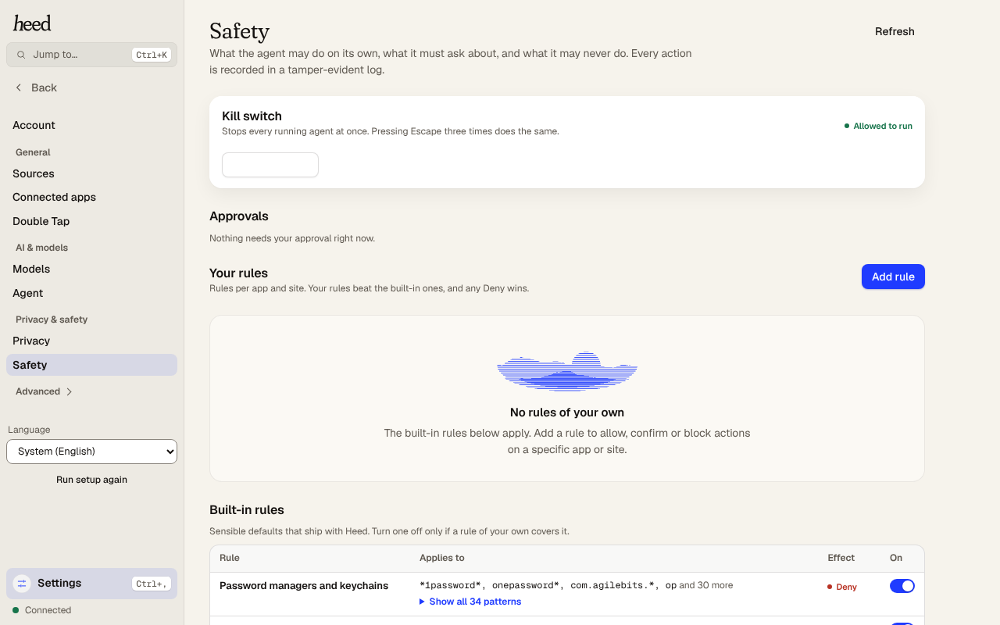

# Safety: rules, confirmations and the kill switch

Everything that acts for you (the [agent](agent.md), the browser extension and actions on
[Today cards](today.md)) asks one safety policy before every action. You manage it on the **Safety**
page.

<picture>
  <source media="(prefers-color-scheme: dark)" srcset="../images/screenshots/safety-dark.png">
  
</picture>

## Risk classes

Each action declares a risk class. A fixed classifier also looks at it (buttons such as "Send" or
"Delete", payment and password fields, the app or site) and can only **raise** the class.

| Class | Covers |
|---|---|
| Observe | Reading, navigating, scrolling, focusing |
| Edit | Typing, selecting, opening a draft: undoable, nothing leaves the device |
| Send | Email, message, form submit, post |
| Destroy | Delete, archive, overwrite a file, cancel a subscription |
| Spend | Purchase, booking, payment, signing |
| Security | Passwords, permissions, installs, settings |

## Rules

| Default rule | Effect |
|---|---|
| Password managers and keychains | **Deny** |
| Banking, brokerage and payment apps and sites | **Deny** |
| OS security, privacy and account settings | **Deny** |
| Send, Destroy, Spend and Security actions | **Confirm** |
| Observe and Edit actions | **Allow** |

You can turn default rules off and add your own per app or site (allow, confirm or deny, optionally
for given risk classes). **Deny always wins.** Otherwise an approval you gave in this task applies,
then your most specific rule, then the defaults; with no match, Send and above need confirmation.

An allow rule that names no risk classes covers only Observe and Edit; to skip confirmation for
sending, deleting, spending or security changes, name that class explicitly.

## Confirmations

A confirmation shows the risk class, target and a preview (see
[the agent guide](agent.md#confirmations)). No answer within 2 minutes, or the kill switch engaged
while it waits, counts as a denial. The **Safety** page lists approvals currently in force.

## Rate limits

Per task, at most 25 Send, 25 Destroy, 3 Spend and 3 Security actions (allowed or approved). Observe
and Edit are unlimited.

## The kill switch

Press **Escape three times**, each within half a second, and everything Nugget does for you stops:
running agents, pending confirmations (denied) and the browser extension. **Stop all agents** in the
tray, or the switch on the **Safety** page, does the same.

- It only halts. Resuming is a deliberate action in the app, never a key press.
- Only Escape is recognised; no other key is recorded.
- On macOS it needs Accessibility permission. On Linux Wayland, Escape ×3 can't be observed; use
  the tray or the **Safety** page.

## The action log

Every decision and action goes to an append-only, hash-chained log, so edits, deletions or reordering
are detected (cutting entries off the end is detectable only against a remembered chain head).
Secure-field text is `[redacted]` and card numbers are masked. Export it as JSON Lines from the
**Safety** page, and verify an exported copy there.
