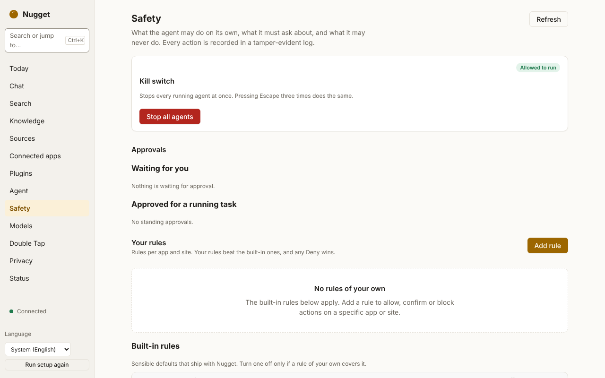

# Safety: rules, confirmations and the kill switch

> **Status:** the policy, confirmations, the kill switch and the action log work in the app: the
> **Safety** page, Escape ×3 and the tray's **Stop all agents** item. The daemon serves
> `policy.get`, `policy.set`, `policy.approvals`, `policy.kill`, `policy.resume` and
> `policy.log.export`. Escape ×3 needs Accessibility permission on macOS and is not available on
> Linux Wayland, where a chord is used instead.

Everything that acts on your behalf (the [agent](agent.md), the browser extension and the actions
on [Today cards](today.md)) asks one safety policy before every action. You manage it on the
**Safety** page.

<picture>
  <source media="(prefers-color-scheme: dark)" srcset="../images/screenshots/safety-dark.png">
  
</picture>

## Risk classes

Each action declares a risk class. A deterministic classifier also looks at the action (button
labels such as "Send" or "Delete", payment and password fields, the app or site) and can only
**raise** the declared class, never lower it.

| Class | Covers |
|---|---|
| Observe | Reading, navigating, scrolling, focusing |
| Edit | Typing into a field, selecting, opening a draft: undoable, nothing leaves the device |
| Send | Sending something to another person or service: email, message, form submit, post |
| Destroy | Removing or overwriting data: delete, archive, overwrite a file, cancel a subscription |
| Spend | Spending money or committing to an obligation: purchase, booking, payment, signing |
| Security | Changing security or system state: passwords, permissions, installs, settings |

## The default rules

| Rule | Effect |
|---|---|
| Password managers and keychains | **Deny** |
| Banking, brokerage and payment apps and sites | **Deny** |
| OS security and privacy settings, and the security, privacy and account panes of system settings | **Deny** |
| Send, Destroy, Spend and Security actions | **Confirm** |
| Observe and Edit actions | **Allow** |

You can turn a default rule off and add your own rules per app or site (allow, confirm or deny,
optionally for given risk classes). Rules and approvals are kept under the data directory.

## How a decision is made

In this order:

1. If the kill switch is engaged: **deny**.
2. The effective risk is the higher of the declared and the classified risk.
3. Any matching **deny** rule, yours or a default: **deny**. Deny always wins.
4. An approval you gave earlier in this task for this risk class and target: **allow**.
5. Your most specific matching allow or confirm rule; on a tie, confirm.
6. The most specific matching default allow or confirm rule.
7. Nothing matched: **confirm** for Send and above, **allow** otherwise.
8. If this task has used up its limit for the risk class: **deny**.

An allow rule that names no risk classes covers only Observe and Edit. To allow sending, deleting,
spending or security changes without a confirmation, a rule must name that class explicitly.

## Confirmations

A confirmation shows the risk class, the target and a preview, and offers approve once, approve for
this task, or deny (see [the agent guide](agent.md#confirmations)). If you do not answer within
2 minutes, or the kill switch is engaged while it waits, it counts as a denial. The **Safety** page
lists the approvals currently in force (`policy.approvals`).

## Rate limits

Per task, at most:

| Class | Actions per task |
|---|---|
| Send | 25 |
| Destroy | 25 |
| Spend | 3 |
| Security | 3 |

Observe and Edit are not limited. The count includes allowed actions and approved confirmations.

## The kill switch

Press **Escape three times**, each press within half a second of the last, and everything Nugget is
doing on your behalf stops: every running agent, every pending confirmation (denied) and the browser
extension. **Stop all agents** in the tray menu does the same.

- Checking the switch is one atomic read, done before every step and every action and while waiting.
- It only ever halts. Resuming is a deliberate action in the app (`policy.resume`), never a key press.
- The Escape counter recognises Escape and nothing else; no other key is recorded.
- On macOS it needs the Accessibility permission. On Linux under Wayland, Escape ×3 cannot be
  observed; use a chord instead.

## The action log

Every decision and every executed action is written to an append-only action log. Each entry holds
the SHA-256 hash of the previous one, so editing, inserting, deleting or reordering entries breaks
the chain and is detected. Text typed into secure fields is replaced by `[redacted]`, card numbers and
long digit runs are masked, and previews are capped in length.

You can export the log as JSON Lines from the **Safety** page, and verify an exported copy. One limit:
cutting entries off the end is detectable only against a remembered head of the chain.
