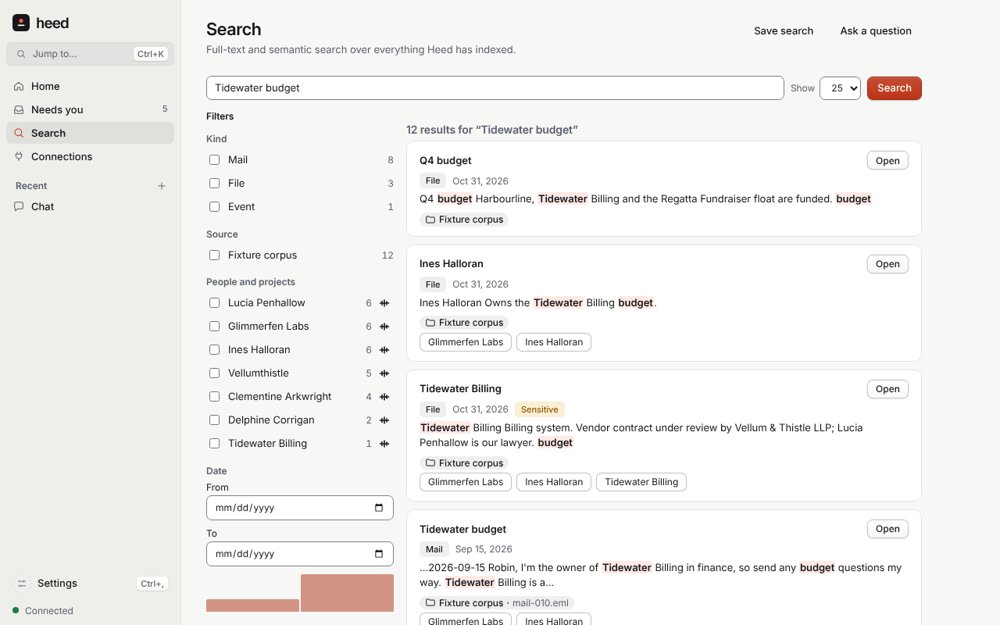
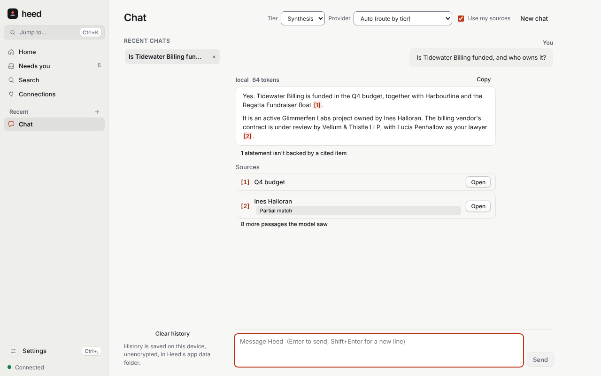

# Search and Ask, with citations

## Search

**Search** returns one result per item (file, message, event or note): its title, the best-matching
passage, and a link that opens the original when the source provides one.

<picture>
  <source media="(prefers-color-scheme: dark)" srcset="../images/screenshots/search-dark.png">
  
</picture>

Search combines full-text and (with an embedding model) vector search, keeps one hit per item, and
demotes near-duplicates. Without an embedding model it is **full-text only**, and the Indexing widget
says so; older items are embedded once a model is available. Queries never go to a cloud embedder
unless you set [`retrieve.allow_cloud_embedding`](../reference/config.md#retrieve). For filters and
timelines, see [Finding anything](search.md).

## Ask

**Ask a question** (on the Search page) packs the most relevant passages, numbered, into a token
budget for the first `synthesis` provider, which is told to answer only from them, cite them as
`[1]`, `[2][3]`, and say when they don't contain the answer. Each `[n]` links to its source.

The **Chat** page works the same way when **Use my sources** is on. If an answer fails (for example
the on-device model stopped), **Retry** asks again; see
[Troubleshooting](troubleshooting.md#the-on-device-model-is-warming-up-stopped-or-wont-start).

<picture>
  <source media="(prefers-color-scheme: dark)" srcset="../images/screenshots/chat-dark.png">
  
</picture>

**What citations promise.** Every `[n]` refers to a real passage sent to the model, and the list of
passages is shown with the answer. Heed does not yet check that each sentence is supported by the
passage it cites.

**Sensitive items and cloud models.** With a cloud model, items marked
[sensitive](privacy.md#sensitive-items) (or not yet classified) are left out, and the answer says how
many. With an on-device or local-network model nothing is withheld. Every Ask to a non-local model is
in the [egress ledger](privacy.md) as `ask`, with the items included.

## From other programs

- [`search`](../reference/ipc.md#search) returns hits.
- [`retrieve.context`](../reference/ipc.md#retrieval) returns the packed, cited passages without
  calling a model.
- [`retrieve.ask`](../reference/ipc.md#retrieval) runs Ask and streams the answer.
- Over [MCP](mcp.md), the `search` and `get_context` tools do the same, limited to the sources each
  app may see.

The same cited retrieval feeds [Double Tap](double-tap.md) drafts.
