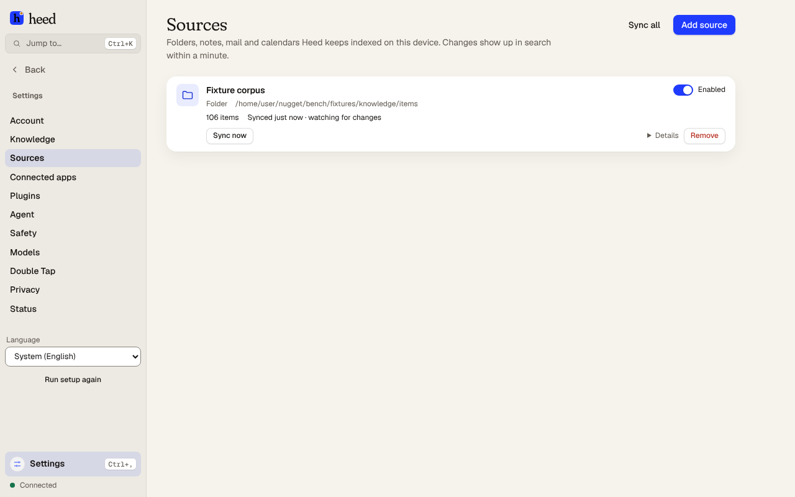

# Adding sources

A **source** is one configured connector: a folder, a vault, a mailbox, an account. Add them on the
**Sources** page, which shows each source's state, item count, last sync and last error, with
**Sync now**, **Disable** and **Remove**.

<picture>
  <source media="(prefers-color-scheme: dark)" srcset="../images/screenshots/sources-dark.png">
  
</picture>

| Kind | What it indexes | Sign-in | How changes arrive |
|---|---|---|---|
| [`files`](sources-files.md) | Folders on this machine | None | Live watcher |
| [`obsidian`](sources-obsidian.md) | An Obsidian vault | None | Live watcher |
| [`gmail`](sources-google.md) | Gmail, read-only | Connect (Google) | Every 60 s |
| [`gcal`](sources-google.md) | Google Calendar, read-only | Connect (Google) | Every 5 min |
| [`gdrive`](sources-google.md#google-drive) | Google Drive documents, read-only | Connect (Google) | Every 5 min |
| [`imap`](sources-imap-caldav.md) | Any IMAP mailbox over TLS | Password or app password | IMAP IDLE, plus polling |
| [`caldav`](sources-imap-caldav.md) | Any CalDAV calendar over https | Password or app password | Every 5 min |
| [`outlook`](sources-microsoft.md) | Outlook / Exchange Online mail | Connect (Microsoft) | Every 60 s |
| [`outlook-calendar`](sources-microsoft.md) | Your default Outlook calendar | Connect (Microsoft) | Every 5 min |
| [`onedrive`](sources-microsoft.md) | OneDrive documents | Connect (Microsoft) | Every 5 min |
| [`slack`](sources-saas.md#slack) | Your DMs and channels | Connect, or pasted user token | Every 5 min |
| [`notion`](sources-saas.md#notion) | Pages shared with your integration | Pasted integration secret | Every 5 min |
| [`github`](sources-saas.md#github) | Issues, PRs and discussions involving you | Connect (device flow), or token | Every 10 min |
| [`linear`](sources-saas.md#linear) | Issues assigned to, created by or followed by you | Connect, or API key | Every 5 min |
| [`imessage`](sources-messaging.md#imessage) | Messages on this Mac (macOS only) | None; needs Full Disk Access | Every 2 min |
| [`whatsapp`](sources-messaging.md#whatsapp) | Chats you export into a folder | None | Folder watcher |
| [`telegram`](sources-messaging.md#telegram) | A Telegram Desktop JSON export | None | Folder watcher |

**Connect** signs in with Nugget's own app for that service, with nothing to register. Each page
also has **Advanced: use your own OAuth client**, which builds from source usually need (Google and
Microsoft then require it; Slack, GitHub and Linear fall back to a pasted token). **Disconnect** signs
a source out and revokes Nugget's access where the service allows it. Notion has no Connect: its
OAuth needs a server-held secret.

Message sources are [private by default](sources-messaging.md#private-by-default); Signal is
[not supported](sources-messaging.md#signal). Apple Notes and Mail are planned.

**Plugin connectors** (`plugin:<plugin id>`) are installed on the [**Plugins**](plugins.md) page and
available after a restart; the Add source wizard doesn't list them yet. They reach only the hosts
they declared and never use OAuth.

## What every source guarantees

- **Edits and deletes propagate.** Changed items are re-indexed, deleted ones disappear, and a rename
  is a delete plus a new item.
- **Read-only.** Connectors never change your data; IMAP messages are not marked read.
- **Resumable.** Progress is saved only after items are stored, so a restart never skips anything.
- **Secrets stay in the OS keychain**, never in `sources.toml`, logs, the audit log or IPC responses.
- **Every network request is in the egress ledger** as `sync:<kind>` (for example `sync:gmail`).

**Known limitation:** account connectors are tested against mock servers, not yet against live
accounts. Please [report](#reporting-a-problem) anything that misbehaves.

## States and health

A source's state is `syncing`, `watching` (up to date, live changes), `idle` (waiting for the next
poll), `needs_auth`, `disabled`, or `error` (retried with backoff up to 15 min). Its **health** line
says what is wrong and what to do (over IPC, `health` in `sources.list`):

| Code | Meaning | What to do |
|---|---|---|
| `ok` | Up to date | Nothing |
| `disabled` | You turned it off | Turn it on; it resumes where it stopped |
| `reconnect` | The service no longer accepts Nugget's sign-in | Sign in again, or set a new password or token |
| `rate_limited` | The service asked Nugget to slow down | Nothing: Nugget waits |
| `offline` | Nugget couldn't reach the service | Check your connection, VPN or proxy |
| `server_error` | The service returned a server error | Nothing: Nugget retries |
| `too_large` | A response or item was over the size limit | Nothing: it is skipped |
| `config` | The service rejected the source's settings | Check the account, folders or paths |
| `item_errors` | Some items couldn't be read and were skipped | Nothing, unless you need them |
| `error` | Anything else | Try **Sync now**, then [Troubleshooting](troubleshooting.md) |

A source that needs you shows a matching button: **Sign in** (Google, Microsoft, Slack, Linear), a
device code (GitHub), **Set password** (IMAP, CalDAV) or **Set token**.

### Reporting a problem

Open an issue with what you did and saw, the source's state and health line, `nuggetd status --json`,
its `sync:<kind>` rows from the [egress ledger](privacy.md#the-egress-ledger), and matching lines from
`logs/nuggetd.<date>.log` in the [data directory](../reference/data-dir.md) (restart with
`NUGGET_LOG=debug nuggetd` for more; `debug` lines can name files and subjects, so read them first).
See [Troubleshooting](troubleshooting.md#reporting-a-bug).

## Removing a source

Removing a source deletes everything indexed from it and its stored credentials, first revoking
Nugget's access where the service allows it (as **Disconnect** does). Over IPC,
`sources.remove` with `"purge": false` keeps the indexed items.

## Without the desktop app

Sources live in `sources.toml`, but change them through the [`sources.*` IPC methods](../reference/ipc.md)
rather than editing the file: the daemon validates settings and stores secrets. Every kind's settings
are in [Connector settings](../reference/connectors.md).
