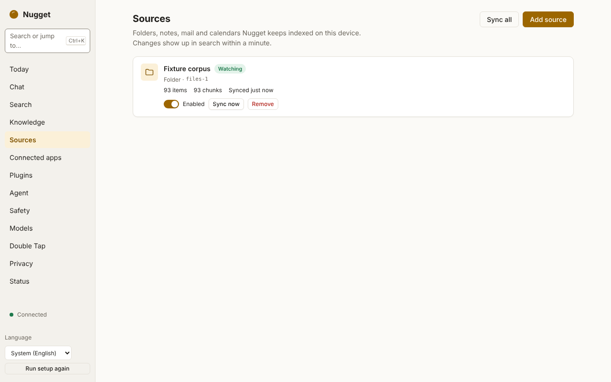

# Adding sources

A **source** is one configured connector: a folder, a vault, a mailbox, a calendar account. Add sources
on the desktop app's **Sources** page. Each one shows its state, item count, last sync and last error,
and has **Sync now**, **Disable** and **Remove** actions.

<picture>
  <source media="(prefers-color-scheme: dark)" srcset="../images/screenshots/sources-dark.png">
  
</picture>

| Kind | What it indexes | Sign-in | How changes arrive |
|---|---|---|---|
| [`files`](sources-files.md) | Folders on this machine | None | Live file-system watcher (about 0.3 s debounce) |
| [`obsidian`](sources-obsidian.md) | An Obsidian vault's notes and attachments | None | Live file-system watcher |
| [`gmail`](sources-google.md) | Gmail, read-only | Your own Google OAuth client | Polled every 60 s (history deltas) |
| [`gcal`](sources-google.md) | Google Calendar, read-only | Your own Google OAuth client | Polled every 5 min (sync tokens) |
| [`gdrive`](sources-google.md#google-drive) | Documents in Google Drive, read-only | Your own Google OAuth client | Polled every 5 min (Drive change feed) |
| [`imap`](sources-imap-caldav.md) | Any IMAP mailbox over TLS | Password or app password | IMAP IDLE on the inbox, plus polling |
| [`caldav`](sources-imap-caldav.md) | Any CalDAV calendar over https | Password or app password | Polled every 5 min (`sync-collection`) |

| Kind | What it indexes | Sign-in | How changes arrive |
|---|---|---|---|
| [`outlook`](sources-microsoft.md) | Outlook / Exchange Online mail, read-only | Your own Microsoft Entra app (client id) | Polled every 60 s (Graph delta queries) |
| [`outlook-calendar`](sources-microsoft.md) | Your default Outlook calendar, read-only | Your own Microsoft Entra app | Polled every 5 min (Graph delta queries) |
| [`onedrive`](sources-microsoft.md) | Documents in OneDrive, read-only | Your own Microsoft Entra app | Polled every 5 min (Graph delta queries) |
| [`slack`](sources-saas.md#slack) | Your DMs and channels | Pasted user token | Polled every 5 min, recent days re-read every 6 h |
| [`notion`](sources-saas.md#notion) | Pages and databases shared with your integration | Pasted integration secret | Polled every 5 min, full listing every 6 h |
| [`github`](sources-saas.md#github) | Issues, pull requests and discussions involving you | Pasted token, or the device flow | Polled every 10 min, full listing daily |
| [`linear`](sources-saas.md#linear) | Issues assigned to, created by or followed by you | Pasted API key, or OAuth with PKCE | Polled every 5 min, full listing every 6 h |

**Plugin connectors** add kinds named `plugin:<plugin id>`, for example
`plugin:dev.nugget.example.feeds` for the example feed reader. They are WebAssembly plugins you install
and approve on the [**Plugins**](plugins.md) page. A new plugin kind is available after Nugget restarts,
and the Add source wizard does not list plugin kinds yet. Each one reaches only the hosts it declared, and its
traffic is in the egress ledger under `sync:plugin:<plugin id>`. A plugin connector signs in with
nothing or with a secret you set, never with OAuth.

The macOS-only sources (Apple Notes, Messages, Mail) are planned and not available yet.

## What every source guarantees

- **Edits and deletes propagate.** A changed file or message is re-indexed, a deleted one disappears
  from search, and a rename is a delete plus a new item. The benchmark checks this for every
  operation.
- **Read-only.** Connectors never change your data. IMAP mailboxes are opened read-only, so messages
  are not marked as read.
- **Resumable.** Progress is saved only after the items before it are stored, so a crash or restart
  never skips anything; at worst a few items are re-checked.
- **Secrets stay in the keychain.** Passwords, API tokens, OAuth tokens and OAuth client secrets go
  to the OS keychain. They never appear in `sources.toml`, logs, the audit log or IPC responses.
- **Every network request is in the egress ledger**, with the feature `sync:<kind>` (for example
  `sync:gmail`).

## States

| State | Meaning |
|---|---|
| `syncing` | Running a sync pass |
| `watching` | Up to date and receiving live changes |
| `idle` | Up to date, waiting for the next poll |
| `needs_auth` | Needs you to sign in again or set a password |
| `disabled` | You turned it off |
| `error` | The last pass failed; it is retried with backoff (2 s, doubling, up to 15 min) |

## Removing a source

Removing a source deletes everything indexed from it (by default) and the credentials stored for it.
Over IPC, `sources.remove` with `"purge": false` keeps the indexed items.

## Without the desktop app

Sources live in `sources.toml` in the config directory, but add and change them through the
[`sources.*` IPC methods](../reference/ipc.md), not by editing that file: the daemon validates
settings and stores secrets. Every kind's settings are in
[Connector settings](../reference/connectors.md).
