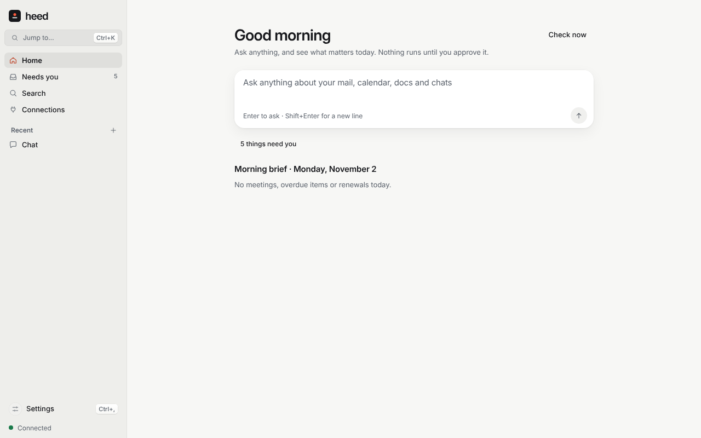

# Today: proactive cards and the morning brief

Heed reads your indexed mail, calendar and knowledge graph and suggests what needs your attention
as **cards**. Each card says why it is there and offers an action you can preview first.

<picture>
  <source media="(prefers-color-scheme: dark)" srcset="../images/screenshots/today-dark.png">
  
</picture>

## Cards

Cards come from fixed rules, not a model:

| Card | When |
|---|---|
| Unanswered thread | Mail from a person you haven't replied to, 1 to 14 days old (newsletters and automated senders never count) |
| Commitment | Yours or owed to you, due within 7 days or up to 30 days overdue |
| Meeting prep | A meeting with outside attendees in the next 48 hours |
| Renewal | A subscription renewal or trial ending within 14 days |
| Follow-up | Something you promised in sent mail in the last 14 days and haven't done |

**Show N sources** opens a card's evidence and the main reasons for its rank. Ranking weighs urgency,
your relationship with the people involved, freshness and card type, and learns from what you
accept, dismiss and snooze. An optional **judge** model (local by default) can add a summary and
suggested action to the top candidates. At most 12 cards are open at once.

Dismissed, done and expired cards are remembered for 90 days so they don't come back. A card whose
situation resolves itself (you replied, the meeting started) closes on its own; others expire after
14 days.

## Acting on a card

| Action | What it does | Risk class |
|---|---|---|
| Draft reply | Drafts a reply in your voice to copy or send from your mail app; Heed never sends it | Edit |
| Create event | Adds an event (through CalDAV if you have a CalDAV source, otherwise an `.ics` file) | Edit; Send with attendees |
| Reminder | Stores a reminder and shows a notification | Edit |
| Archive thread | Archives it (IMAP and Gmail only) | Destroy |
| Research note | Writes a note into your vault | Edit |

Every action shows a **preview** (a dry-run diff) first. Your approval is tied to exactly that
preview: if anything changes, nothing runs. The [safety policy](safety.md) is then asked as for any
action.

## The morning brief

The top of **Today** is a brief for your local date: top cards, today's meetings and their prep,
overdue commitments, renewals in the next 7 days, and open cards. The page also shows card precision
(accepted out of shown).

## Privacy

- Cards are generated and ranked on your device.
- The judge uses a cloud model only if you allow it, never for cards with sensitive evidence, and
  logs those requests in the [egress ledger](privacy.md) (feature `proactive_judge`).
- Draft replies follow the [Double Tap](double-tap.md) rules.
- CalDAV events and archiving go to that source's own server.
